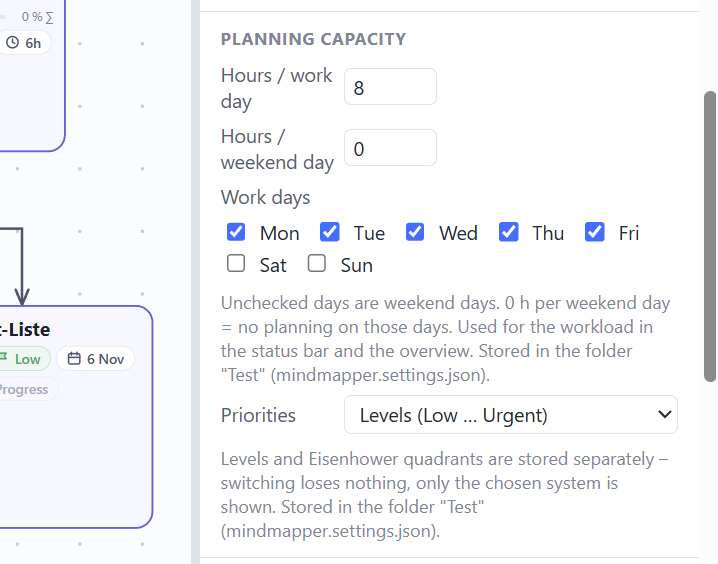
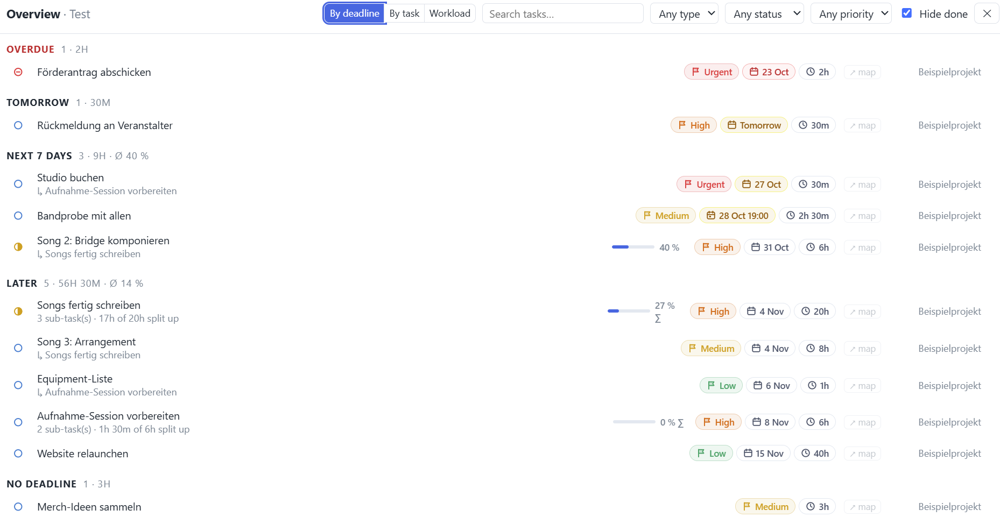
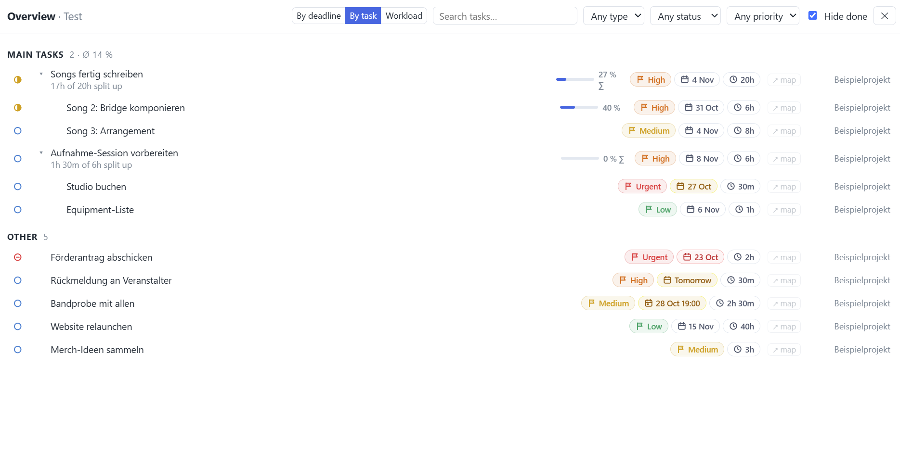
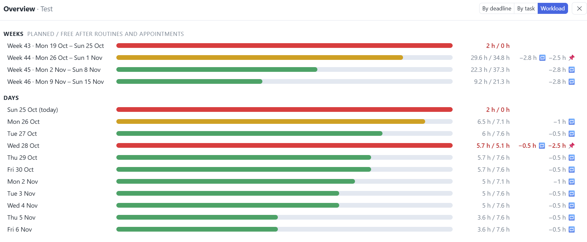
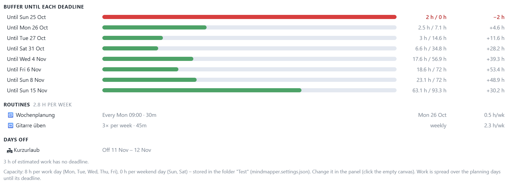
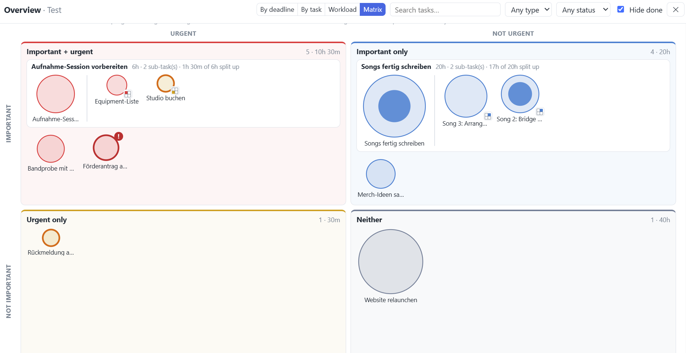
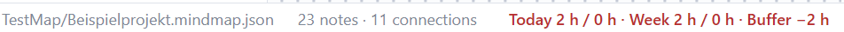

# MindMapper – Handbuch

MindMapper ist ein Mindmap- und Planungswerkzeug, das komplett im Browser läuft – ohne Installation, ohne Konto, ohne Internet. Dieses Handbuch erklärt die wichtigsten Funktionen. Die Bezeichnungen der Oberfläche sind englisch und stehen hier **fett**.

> Tipp: Über den Knopf **?** oben rechts in der Toolbar öffnest du dieses Handbuch und die Beispiel-Map jederzeit wieder. Das **Beispielprojekt** daneben zeigt die Planung in Aktion: Aufgaben mit Untertasks, eine aufgeblähte und eine überfällige Aufgabe, einen Termin, Routinen und Urlaub. **Speichere es zuerst** mit **File → Save as…** in einen Projektordner – am besten einen leeren Testordner, dann steht in der Übersicht nur das Beispiel. Erst dann zeigt die **Overview** seine Aufgaben, denn sie liest die Maps des Ordners. Die Statusleiste rechnet auch ungespeichert schon mit.

## Vorwort: die Idee

MindMapper ist eine Planungssoftware für Menschen, denen lineare Zeitpläne schwerfallen – Kreative, Forschende, Musikerinnen und Musiker, alle, die lieber in Zusammenhängen denken als in Listen. Ein Kalender verlangt, dass man schon weiß, was wann passiert. Hier fängt man anders an:

- **Gedanken sortieren und Aufgaben ableiten – in einem.** Du legst Notes auf eine freie Fläche, verbindest sie mit Pfeilen, gruppierst sie. Was davon eine Aufgabe ist, bekommt Deadline und Schätzung und taucht von selbst in Tages- und Wochenplänen, in der Übersicht und in der Auslastung auf. Die Mindmap bleibt dabei die Quelle; Pläne und Listen sind nur andere Blicke darauf.
- **Tagebuch an dem Ort, an dem der Tag geplant wurde.** Wer schon immer mal Tagebuch schreiben wollte und sich nie dazu aufraffen konnte: Ein Eintrag ist eine Notiz vom Typ *Diary entry* in der Map des Tages – dort, wo man ohnehin gerade ist. Das Tagebuch sammelt sie als Seiten, mit Linierung, Stickern und Bildern. Dasselbe funktioniert als **Laborbuch**: Seiten lassen sich abschließen und halten dann fest, was an diesem Tag galt.
- **Zeitfresser, aufgeblähte Aufgaben und freie Zeit sehen.** Routinen und Termine ziehen ihre Zeit von der Tageskapazität ab, Projektaufgaben verteilen ihren Restaufwand bis zur Deadline. So sieht man, welche Woche schon voll ist, bevor sie anfängt, welche Aufgabe in Wirklichkeit aus fünf Aufgaben besteht, und wo noch Luft ist.
- **Fast keine Regeln.** Welche Notes du anlegst, wie du sie anordnest, ob eine Map ein Wochenplan, ein Projekt oder ein Brainstorming ist – das entscheidest du. Vorlagen und Automatik helfen, zwingen aber nichts auf. Alles sind lesbare Dateien in deinem Ordner, ohne Konto und ohne Cloud. Wer PC und Handy verbinden will, legt den Ordner in einen Cloud-Dienst seiner Wahl – MindMapper kommt mit den Sync-Programmen zurecht (Kapitel 1).

---

## 1. Starten und Speichern

- **Starten:** `index.html` doppelklicken. Empfohlen sind **Edge** oder **Chrome** – nur dort kann MindMapper direkt in Dateien und Ordner schreiben.
- **Menü File ▾** (ganz links in der Toolbar): **New map…** (mit offenem Projektordner: neue Map im Ordner, sonst eine leere, noch ungespeicherte Map), **Open file…** (`Ctrl+O`), **Save** (`Ctrl+S`), **Save as…** (`Ctrl+Shift+S`) und **Map as PDF / print…** (`Ctrl+P`).
- **Einzelne Map ohne Projektordner** (z. B. in Firefox oder am Handy in der lokalen Version): **Open file…** / **Save** / **Save as…** öffnen und speichern eine Datei `*.mindmap.json`. **Save as…** legt auch eine Kopie einer Projekt-Map als Datei ab, z. B. zum Weitergeben.
- **Als PDF / drucken:** **File ▾ → Map as PDF / print…** oder `Ctrl+P`. Im Dialog wählst du **ganze Map**, **sichtbaren Ausschnitt** oder **markierte Notes**, Papier **A4 / A3** und **Quer-, Hochformat oder automatisch**; auf Wunsch stehen Name der Map und Datum oben. Alles wird **auf eine Seite** verkleinert. Für ein PDF im Druckdialog als Drucker „Als PDF speichern“ wählen. Gedruckt wird immer hell (auch im Darkmode); ein aktiver Filter „ausblenden“ gilt auch für den Druck.
- **Projektordner (empfohlen):** In der linken Seitenleiste **Project** → **Open folder…** einen Ordner wählen. Alle Maps darin erscheinen als Liste, Unterordner (z. B. `Weeks/`, `Months/`, `Days/`) werden angezeigt.
  - Maps aus dem Projektordner werden **automatisch gespeichert** (Einstellung „Auto-save project maps into their file“ im Panel rechts, wenn nichts markiert ist).
  - Nach einem Neustart fragt der Browser einmal nach der Erlaubnis: **Reconnect**.
- **Rein lokal:** Diese Version (`index.html`) baut **keine Verbindung nach außen** auf – der Browser blockiert sie (Content-Security-Policy im Kopf von `index.html`). MindMapper hat keine eigene Cloud-Anbindung und spricht mit keinem Server, und Bilder aus dem Netz (Markdown ``) werden nicht geladen; Links öffnest du weiterhin per Klick in einem neuen Tab.
- **Eigene Kopie – die sicherste Art:** Öffnest du MindMapper über eine Internetadresse (z. B. GitHub Pages), lädt der Browser das Programm jedes Mal frisch vom Server. Wer die Konten dahinter übernähme, könnte dort ein anderes Programm hinstellen. Eine Kopie auf deinem Rechner kann dagegen niemand aus der Ferne austauschen:
  1. Auf GitHub im Repo **Code → Download ZIP**.
  2. Die ZIP-Datei an einen beliebigen Ort entpacken, z. B. `Dokumente/MindMapper`.
  3. Darin `index.html` per Doppelklick in Edge oder Chrome öffnen.

  Der Ordner darf liegen, wo du willst – nur `index.html` bleibt darin neben ihren Unterordnern (`js/`, `css/`, `icons/`), allein funktioniert sie nicht. **Updates** kommen nicht von selbst: Für eine neue Version lädst du die ZIP-Datei erneut herunter und ersetzt den Programmordner. Deine Maps liegen im Projektordner, nicht im Programmordner – an ihnen ändert ein Update nichts.
- **Sicherung im Browser:** Zusätzlich wird die offene Map ständig im Browser zwischengespeichert und beim nächsten Start wiederhergestellt.
- **Arbeiten an zwei Rechnern** (z. B. synchronisierter Ordner): Ist die Datei auf der Platte neuer als die Kopie im Browser, lädt MindMapper die Datei. Hattest du lokal ungespeicherte Änderungen, wirst du gefragt.
- **Schutz vor Überschreiben:** MindMapper merkt sich, in welchem Stand eine Map gelesen wurde. Wurde die Datei inzwischen woanders geändert (anderer Rechner, zweiter Tab, Sync-Programm), wird sie **nicht** einfach überschrieben:
  - **Offene Map:** Beim nächsten Speichern fragt MindMapper, welche Version bleiben soll – deine hier oder die andere in der Datei:
    - **Andere Version behalten:** Die Datei wird geladen, deine Änderungen werden verworfen.
    - **Beide behalten:** Deine Version wird als Kopie daneben gespeichert (z. B. `2026-W44 (Konflikt 2026-10-24 1530).mindmap.json`), das Original bleibt unverändert, du arbeitest in der Kopie weiter.
    - **Meine Version behalten:** Die Datei wird überschrieben, die anderen Änderungen gehen verloren.
  - **Andere Maps** (Mit-Abhaken, Move to map, Carry-over, Overview, Umbenennen) und das **Tagebuch:** Statt zu überschreiben, kommt eine Fehlermeldung. Öffne die Map bzw. das Tagebuch neu und wiederhole den Schritt.
  - **Nichts geht still verloren:** Konnte die offene Map nicht gespeichert werden, fragt MindMapper nach, bevor du eine andere Map öffnest oder den Ordner wechselst – mit dem Hinweis, dass du die Änderungen mit **File → Save as…** sichern kannst. Wählst du denselben Ordner erneut, bleibt die offene Map mit ihrer Datei verbunden.
- **Synchronisierter Ordner** (pCloud, Dropbox, Hessenbox, OneDrive, Nextcloud …): Liegt der Projektordner in einem Ordner, den ein Sync-Programm abgleicht, setze im Panel (nichts markiert) das Häkchen **Folder is synced (pCloud, OneDrive …)**. Es gilt für diesen Ordner auf allen Geräten (gespeichert in `mindmapper.settings.json`).
  - **Seltener schreiben:** Mit dem Häkchen schreibt MindMapper eine Map oder das Tagebuch erst **15 s nach der letzten Änderung** in die Datei (sonst nach gut einer Sekunde). Sync-Programme laden jede Schreibaktion hoch; kommt währenddessen die nächste, legen manche eine Konfliktkopie an. Verlässt du die App, wechselst die Map oder schließt den Tab, wird sofort gespeichert. Verschieben und Zoomen schreiben die Datei nie – nur echte Änderungen.
  - **Zurückkommen:** Kehrst du zur App zurück (anderes Fenster, Handy entsperrt), prüft MindMapper, ob die offene Map inzwischen woanders geändert wurde. Hast du hier nichts Ungespeichertes, lädt es die neue Version still nach (Meldung „… wurde woanders geändert – neue Version geladen“); sonst greift der Schutz vor Überschreiben.
  - **Gerätewechsel:** Vor dem Wechsel die App verlassen (das speichert), kurz warten, bis das Sync-Programm fertig ist, und auf dem anderen Gerät **⟳** drücken oder zurück ins Fenster gehen. Dieselbe Map auf zwei Geräten innerhalb weniger Sekunden zu bearbeiten, kann kein Sync-Programm sauber auflösen.
  - **Konfliktkopien aufräumen:** Dateien wie `Üben.mindmap [conflicted 2].json` (pCloud), `… (conflicted copy …)` (Dropbox) oder `… (Konflikt 2026-10-25 1228)` (MindMappers *Beide behalten*) erscheinen nicht als eigene Maps, sondern als orangefarbenes **⚠ n** an ihrer Map in der Seitenleiste. Das Menü dahinter zeigt jede Kopie mit Uhrzeit und „gleicher Inhalt“, wenn sie dem Original gleicht: **Kopie öffnen** (nur zum Vergleichen), **Diese Version behalten…** (ersetzt die Map durch die Kopie; bei Plänen werden Routinen und Termine danach nachgetragen), **Kopie löschen…**, **Die n Kopien mit gleichem Inhalt löschen**, **Alle n Kopien löschen…**. Eine Kopie ohne Original bleibt eine normale Map.
  - **Leere Dateien:** Zeigt ein Sync-Programm eine Datei schon an, bevor ihr Inhalt da ist, öffnet MindMapper sie nicht als leere Map, sondern meldet „… ist gerade leer oder unvollständig“. Später noch einmal versuchen.
  - **Am Handy:** Wie gut es klappt, hängt von der App des Sync-Dienstes ab. Chrome auf Android öffnet einen Ordner über die Dateiauswahl des Handys. Manche Apps geben dort einen Ordner nur „offline verfügbar“ heraus (z. B. die pCloud-App) – das ist eher eine Warteschlange für Uploads als ein Ordner: Änderungen kommen oft erst nach Minuten an, Anlegen oder Löschen kann scheitern. Zuverlässiger sind Apps, die einen **echten Ordner im Handyspeicher** in beide Richtungen abgleichen (z. B. FolderSync). Am PC ist ein Sync-Ordner ein ganz normaler Ordner.
  - **Keine Cloud-Anbindung in MindMapper:** Bewusst. MindMapper hält keine Zugangsschlüssel zu deinem Cloud-Konto und spricht mit keinem Server – den Abgleich macht das Sync-Programm deines Anbieters, dem du ohnehin vertraust.

## 2. Grundbedienung

| Aktion | So geht's |
|---|---|
| Note einfügen | Rechtsklick auf die leere Fläche → **Insert**, oder **+ Insert** in der Toolbar |
| Text bearbeiten | Doppelklick, oder `Enter` / `F2` |
| Verbundene Note anlegen | `Tab` (rechts neben der markierten Note) |
| Verbinden | Maus über eine Note → blauen Punkt auf eine andere Note ziehen (auf die leere Fläche ziehen = neue Note). Ankerpunkte: drei je Seite, bei großen Notes (breiter oder höher als eine Standard-Task-Note) fünf. Bei gedrehten Bildern und Emoji-Notes drehen die Ankerpunkte mit. |
| Verschieben / Größe | Ziehen; Ecken und Kanten der Markierung ziehen |
| Mehrere markieren | Rahmen aufziehen, oder `Shift` / `Ctrl` + Klick |
| Ansicht verschieben | `Leertaste` + Ziehen oder mittlere Maustaste |
| Zoomen | Mausrad, `+` / `-` oder der Knopf mit der Zoomstufe (z. B. **100% ▾**: hinein, heraus, 100 %); **Fit** bzw. `Shift+1` zeigt alles |
| Kopieren / Einfügen / Duplizieren | `Ctrl+C` / `Ctrl+V` / `Ctrl+D` |
| Rückgängig / Wiederholen | `Ctrl+Z` / `Ctrl+Y` |
| Löschen | `Entf`; bei Tasks auch der Papierkorb an der Unterkante rechts (beim Überfahren / Markieren) |

- **Rechtsklick** auf eine Note, eine Verbindung oder die Fläche öffnet ein Menü mit allen passenden Befehlen.
- **Am Handy / Tablet (Finger):**

  | Geste | Wirkung |
  |---|---|
  | Wischen (auch auf einer Note) | Map verschieben – Notes bleiben, wo sie sind |
  | Zwei Finger auseinander / zusammen | Zoomen (um die Stelle zwischen den Fingern) |
  | Antippen | wie ein Klick: markieren, Kästchen abhaken, Chip-Menü öffnen, leere Fläche = Markierung aufheben |
  | Doppeltippen | Text bearbeiten (Tastatur erscheint) |
  | Halten (kurzes Vibrieren) und loslassen | Kontextmenü – wie Rechtsklick |
  | Halten und dann ziehen | Note verschieben; auf der leeren Fläche: Auswahlrahmen |
  | Zwei Finger auf einem markierten Bild / Emoji | drehen und vergrößern / verkleinern |
  | Griffe und blaue Ankerpunkte | wie mit der Maus (Größe ändern, verbinden); an der markierten Note sind sie größer und immer sichtbar. Um jeden Griff liegt ein unsichtbarer, fingergroßer Trefferbereich; ein kleines Emoji oder Bild bekommt einen Mindestrahmen (gestrichelt), damit die Griffe nicht übereinanderliegen. Pfeile lassen sich auch weit herausgezoomt antippen. |

  Auf schmalen Bildschirmen liegt die Seitenleiste **Project** als Schublade über der Map (schließt sich nach dem Öffnen einer Map) und das **Panel** als Blatt am unteren Rand; beide blendest du mit den Knöpfen *Project* / *Panel* ein und aus. Die Toolbar lässt sich seitlich wischen. Die **Overview** füllt am Handy den Bildschirm (auch quer – dort ist ihre Kopfzeile eine wischbare Zeile), die Zeilen sind zweizeilig.
- Das **Panel rechts** zeigt die Eigenschaften der Markierung: Typ, Form, Farben, Details. Ist nichts markiert, stehen dort die Einstellungen.
- **Smart guides** und **Grid** helfen beim Ausrichten. `Alt` beim Ziehen schaltet das Einrasten aus.
- **`Ctrl` beim Ziehen** nimmt alles mit, was unter der Note hängt: Notes, auf die ihre Pfeile zeigen (beliebig tief), bei einer Gruppe deren Inhalt, und verankerte Zeichnungen. `Ctrl` darf auch erst während des Ziehens gedrückt oder losgelassen werden – die Unter-Notes kommen dann dazu bzw. springen zurück.
- Verbindungen: Rechtsklick → **Route** (gerade, Winkel, Kurve), **Line**, **Reverse direction**. Doppelklick auf eine Verbindung = Beschriftung.

## 3. Notiztypen

| Typ | Wofür |
|---|---|
| **Note** | Einfacher Text |
| **Heading** | Überschrift, größer und fett |
| **To-Do** | Abhakbare Liste (`Enter` = neuer Eintrag) |
| **Outline** | Gegliederte Stichpunkte (`Tab` / `Shift+Tab` = ein-/ausrücken, Klick auf den Punkt = zuklappen) |
| **Task** | Aufgabe mit Stichpunkten und immer sichtbaren Details (Status, Priorität, Deadline, Schätzung, Fortschritt) |
| **Link** | Verweis auf eine andere Map oder eine Webadresse |
| **Code** | Text in Festbreitenschrift |
| **Markdown** | Formatierter Text: Tabellen, Überschriften, Listen, Kästchen, Links, Bilder – geschrieben mit ein paar Zeichen (siehe **Markdown-Zeichen** in Kapitel 16). Wächst mit ihrem Inhalt. Wie ein Tagebuch-Eintrag, nur ohne Tagebuch und Datum |
| **Diary entry** | Tagebuch-Eintrag mit Tag und Uhrzeit, erscheint im gewählten Tagebuch (siehe Kapitel 16) |
| **Group** | Rahmen – Notes darin werden mitbewegt |
| **Image** | Bild (einfügen per Drag & Drop oder `Ctrl+V`); auch als **Overlay** über allem |
| **File** | Datennote: eine beliebige Datei (siehe Kapitel 16) |

Den Typ änderst du per Rechtsklick → **Change type** oder im Panel. Wird eine To-do-Liste, Outline oder Task zu **Markdown**, steht ihr Titel danach als Überschrift über ihrer Liste – To-do-Einträge als Kästchen, Outline-Punkte eingerückt.

## 4. Details: Status, Priorität, Deadline, Termin, Schätzung, Tags

- Im Panel unter **Details**: **Deadline**, **Scheduled** (Termin), **Estimate** (z. B. `1h 30m`, `90m`, `2h`, `1d` = ein Arbeitstag, also so viele Stunden wie unter *Hours / work day* eingestellt; gespeichert wird beim Eintippen der Stundenwert), **Progress** (nur Tasks), **Status**, **Priority**, **Tags**, **Link**.
- **Deadline oder Termin – nie beides:**
  - **Deadline** = bis wann es fertig sein muss. Die Zeit wird auf die Tage bis dahin verteilt (Projektarbeit).
  - **Scheduled / Termin** = an welchem Tag (optional mit Uhrzeit) es stattfindet, z. B. ein einmaliger Workshop. Die geschätzte Zeit wird wie bei einer Routine von der **Kapazität dieses Tages** abgezogen (📌-Chip).
  - Wer eins setzt, löscht das andere.
- Die Werte erscheinen als kleine **Chips** unter der Note (Toolbar **Details** blendet sie ein/aus).
- **In Tasks** genügt ein Klick auf einen Chip: Es öffnet sich direkt ein Auswahlmenü (z. B. *Tomorrow*, *Next Monday*, *1h 30m*, *50 %*).
- Status und Fortschritt hängen zusammen: 100 % → *Done*; *Done* → 100 %.
- **Priorität:** zwei Systeme zur Wahl – siehe unten **Prioritäten: Stufen oder Eisenhower**.
- **Link** im Panel: eine Map des Projekts, eine Webadresse oder ein **Ordner / eine Datei auf dem PC** (`C:\Projekte\Abrechnung`, `\\server\share\Team`; „Als Pfad kopieren“ aus dem Explorer funktioniert auch). Der kleine **↗**-Knopf an der Note (oder `Ctrl+Klick`) öffnet ihn.
  - Ein Ordner öffnet sich als Dateiliste in einem neuen Browser-Tab. Den Windows-Explorer selbst darf der Browser nicht starten – dafür kopiert MindMapper den Pfad in die Zwischenablage: `Win+E`, `Ctrl+L`, `Ctrl+V`.

### Estimate: wie viel Arbeit steckt darin – und warum das zählt

**Estimate** (Schätzung) ist deine Einschätzung, wie viel **Arbeitszeit** eine Sache insgesamt braucht – nicht, wie lange sie im Kalender dauert. „Bericht schreiben: 6h“ heißt sechs Stunden Arbeit, egal ob sie an einem Tag oder verteilt über zwei Wochen anfallen.

- **Eingabe:** im Panel unter **Details → Estimate** oder per Klick auf den ⏱-Chip einer Task: `90m`, `1h 30m`, `2h`, `1d` (= ein Arbeitstag, also so viele Stunden wie unter *Hours / work day* eingestellt; gespeichert werden die Stunden).
- **Warum sie wichtig ist:** Die Schätzung ist die eine Zahl, aus der MindMapper alles Weitere rechnet. Ohne sie ist eine Aufgabe nur ein Eintrag in einer Liste – mit ihr weiß das Programm, ob deine Woche aufgeht:
  - **Projektaufgabe** (*Deadline* + *Estimate*): Der Restaufwand wird auf die Tage bis zur Deadline verteilt und erscheint in der Auslastung (Kapitel 13).
  - **Routine** oder **Termin** (*Repeat* / *Scheduled* + *Estimate*): Die Zeit wird an ihren Tagen von der Kapazität abgezogen – diese Stunden stehen für Projektarbeit nicht mehr zur Verfügung.
  - **Restaufwand** = Schätzung × (1 − Fortschritt). Eine 6-h-Aufgabe mit 50 % zählt noch 3 h.
  - **Statusleiste, Puffer, Matrix:** Alle drei rechnen damit. In der Eisenhower-Matrix ist die **Kreisfläche** die Schätzung – aufgeblähte Aufgaben fallen dort sofort auf.
  - **Ohne Schätzung** zählt eine Aufgabe mit Deadline oder Termin **nicht** mit. Die Statusleiste meldet sie als „n without estimate“, damit nichts unbemerkt durchrutscht.
- **Wie genau?** Grob genügt. Lieber etwas zu großzügig als zu knapp – eine Schätzung, die später nicht passt, korrigierst du einfach; die Planung rechnet sofort neu. Wird eine Aufgabe größer als ein, zwei Tage, lohnt es sich, sie in **Untertasks** zu zerlegen (Kapitel 12): Die Schätzung der Haupttask ist dann der Gesamtaufwand, die Untertasks teilen ihn auf.

### Prioritäten: Stufen oder Eisenhower

MindMapper kennt zwei Arten, Wichtigkeit festzuhalten. Pro Projektordner gilt eine davon.

- **Umstellen:** Im Panel rechts, wenn **nichts markiert** ist (leere Fläche anklicken) → Abschnitt **Planning capacity** (*Planungskapazität*) → Auswahl **Priorities** (*Prioritäten*): **Levels (Low … Urgent)** oder **Eisenhower**. Gespeichert in `mindmapper.settings.json` des Ordners – ein Arbeitsordner kann Eisenhower nutzen, ein privater die Stufen.

- **Stufen** (*Levels*): eine Skala **None – Low – Medium – High – Urgent** (*Keine – Niedrig – Mittel – Hoch – Dringend*), farbig von grün bis rot. Schnell gesetzt, gut für viele kleine Aufgaben. Sortiert und gefiltert wird nach dieser Reihenfolge.
- **Eisenhower:** Statt einer Stufe beantwortest du für jede Aufgabe zwei Fragen – **Ist es wichtig?** und **Ist es dringend?** Daraus entstehen vier Felder plus „noch offen“ (Tabelle unten). Die Namen beschreiben nur den Zustand, sie schreiben keine Handlung vor. Eisenhower hilft vor allem, wenn sich alles gleich dringend anfühlt: Es trennt *wichtig* von *dringend* und zeigt, welche wichtigen Aufgaben ständig liegen bleiben. Nur in diesem Modus gibt es in der Overview die **Matrix** (Kapitel 11).

| Eisenhower-Feld | Bedeutung |
|---|---|
| **Important + urgent** (*Wichtig + dringend*) | zählt und drängt |
| **Important only** (*Nur wichtig*) | zählt, hat aber noch Zeit – hier passiert die eigentliche Arbeit, wenn man sie einplant |
| **Urgent only** (*Nur dringend*) | drängt, bringt dich aber nicht weiter |
| **Neither** (*Weder noch*) | weder wichtig noch dringend |
| **Not classified** (*Nicht eingeordnet*) | noch nicht entschieden |

- **Setzen an der Note:** im Panel unter **Details → Priority** bzw. **Eisenhower**, bei Tasks auch per Klick auf den Chip. In der Matrix zusätzlich per Ziehen.
- **Wechseln verliert nichts:** Stufe und Eisenhower-Feld werden getrennt gespeichert. Beim Umstellen wird nichts umgerechnet und nichts gelöscht; Chips, Panel, Filter und Übersicht zeigen nur das gewählte System. Stellst du zurück, ist die alte Einordnung wieder da.

## 5. Die Task: Projektaufgabe, Termin oder Routine

Fast alles in MindMapper dreht sich um Aufgaben: Auslastung, Pläne, Overview, Routinen. Aufgaben sind Notes vom Typ **Task**: Sie zeigen ihre Details als Chips mit Klickmenü, haben Fortschritt und Untertasks. **Was** für eine Aufgabe eine Task ist – Projektaufgabe, Termin oder Routine – entscheiden die Felder, die du im Panel unter **Details** setzt.

**Die Grundfrage – drei Fragen, eine Antwort:**
- Kommt es **regelmäßig** wieder (jeden Dienstag, 5 h pro Woche)? → **Routine** (*Repeat*)
- Findet es an einem **bestimmten Tag** statt (Workshop am 12.11., 9:00)? → **Termin** (*Scheduled*)
- Muss es **bis zu einem Tag fertig** sein (Bericht bis Freitag)? → **Projektaufgabe** (*Deadline*)
- Dazu fast immer: **wie lange** dauert es? → *Estimate*. Ohne Schätzung kann MindMapper keine Zeit einplanen.

### Jede Note lässt sich in eine Task umwandeln

Das Besondere an MindMapper ist die **freie Struktur**: Du musst nicht vorher wissen, was aus einem Gedanken wird. Jede Note – eine einfache Note, eine Überschrift, eine To-do-Liste oder eine Outline – lässt sich jederzeit in eine Task umwandeln, ohne sie neu anzulegen.

**Beispiel:** Du notierst einen Gedanken als einfache Note – „Workshop für die neuen Studierenden?“. In den nächsten Tagen hängen sich weitere Notes daran: Themen, Raum, wer hilft mit. Irgendwann ist klar: Das ist kein Gedanke mehr, das ist eine Aufgabe.
1. Rechtsklick auf die Note → **Change type → Task**. Text, Tags und alle Verbindungen bleiben erhalten (Einträge einer To-do-Liste werden zu Stichpunkten).
2. Hängen an ihr weitere Notes, fragt MindMapper: *„Auch die 3 Note(s) darunter zu Tasks machen?“* – mit **Ja** wird der ganze Zweig zu Tasks, und die angehängten Notes sind jetzt ihre **Untertasks** (geteilte Schätzung, Fortschritt ∑, Kapitel 12). Später geht das auch per Rechtsklick → **Make tasks (with notes below)**.
3. Details setzen: *Estimate* `6h` und *Deadline* – fertig ist die Projektaufgabe. Mit *Scheduled* statt Deadline wird sie zum Termin, mit *Repeat* zur Routine.

Mitgenommen werden Notes, Überschriften, To-do-Listen und Outlines, die per Pfeil darunter hängen (beliebig tief); Bilder, Dateien, Gruppen, Links und Code bleiben, wie sie sind. Ein `Ctrl+Z` macht die ganze Umwandlung wieder rückgängig.

### Was wird aus meiner Task?

Es gilt die **erste** Zeile, die passt:

| Gesetzt im Panel | Die Task ist … | Wirkung auf deine Zeit | Wo sie auftaucht |
|---|---|---|---|
| *Repeat* wöchentlich / monatlich | 🔁 **Routine** mit festen Tagen (blaues 🔁) | zieht ihre *Estimate* an jedem ihrer Tage von der Kapazität ab | Tages- und Wochenplan (Spalte des Tages), Workload → *Routines* |
| *Repeat* *Time budget per week* / *Several times per week* | 🔁 **Routine** ohne feste Tage | der Wochenanteil wird auf die Arbeitstage der Woche verteilt | Wochenplan: Liste ihrer Kategorie (bzw. *Routines this week*) |
| *Repeat* in einer **Nice-to-have-Kategorie** | 🔁 **Nice-to-have-Routine** (orangefarbenes 🔁) | **keine** – wird nicht angerechnet, nur zum Abhaken und Dranbleiben | wie oben; Workload-Seite ausgegraut |
| *Repeat* *Day(s) off / vacation* | 🏖 **Urlaub / frei** | Tag ohne Kapazität (oder weniger, wenn *Estimate* gesetzt) | 🏖-Eintrag im Plan |
| *Scheduled* (Termin, optional Uhrzeit) | 📌 **Termin** | blockt die *Estimate* an genau diesem Tag – auch abgehakt | Tages- und Wochenplan, Overview, Workload (`−2 h 📌`), Konfliktmeldung |
| *Deadline* + *Estimate* | **Projektaufgabe** | der Restaufwand wird auf die Tage bis zur Deadline verteilt | Overview, Matrix, Workload, Puffer, Statusleiste (Kapitel 11) |
| nur *Estimate* | Aufwand **ohne Frist** | wird nicht verteilt, nur gemeldet („… h ohne Deadline“) | Overview, Hinweis auf der Workload-Seite |
| nur *Deadline* | Frist **ohne Aufwand** | zählt nicht – Hinweis „without estimate“ | Overview |
| nichts davon | offene Aufgabe | keine | Overview |

**Gut zu wissen:**
- **Repeat schlägt alles.** Eine Task mit Regel ist immer eine Routine; Deadline oder Termin daneben spielen keine Rolle. Routinen stehen nicht in den Aufgabenlisten des Overview, sondern auf der Workload-Seite unter *Routines* (mit Verlauf ▣□).
- **Termin oder Deadline – nie beides.** Wer eins setzt, löscht das andere (Kapitel 4).
- **Erledigt** (*Done*, 100 %) oder **verschoben** (→ andere Map) zählt nicht mehr als Arbeit. Ausnahme **Termin**: Abgehakt bleibt seine Zeit an dem Tag reserviert – er hat ja stattgefunden. Vergangene Tage zählen nie.
- **Fortschritt** verringert den Restaufwand: 10 h geschätzt, 40 % erledigt → 6 h werden noch verteilt.
- **To-do-Listen** (z. B. die Spalten der Tages- und Wochenpläne) zählen nur mit Schätzung, anteilig nach offenen Einträgen (4 von 8 offen → halbe Schätzung).
- **Haupt- und Untertasks** teilen sich eine Schätzung (Kapitel 12); eine große Aufgabe bekommt bei Bedarf ihre eigene Map (Kapitel 10).

### Der Weg einer Task

1. **Festhalten:** Rechtsklick → **Insert → Task**, Stichpunkte notieren. Noch ohne Felder ist sie nur eine offene Aufgabe im Overview.
2. **Planen:** *Estimate* und *Deadline* setzen (Klick auf die Chips). Jetzt rechnet MindMapper: Die Statusleiste zeigt, wie sich die Woche füllt, das Panel unter **Workload**, wie viel Puffer bis zur Deadline bleibt.
3. **Aufteilen:** Große Aufgaben per Pfeil in Untertasks zerlegen – der Fortschritt der Haupttask rechnet sich dann selbst (∑).
4. **Termin daraus machen:** Wird aus „Workshop vorbereiten bis Freitag“ ein fester Block („Workshop, Do 9:00, 3 h“), *Scheduled* setzen: Die Deadline verschwindet, die Zeit ist an dem Tag geblockt, und 📌 steht im Tages- und Wochenplan. Den 📌 im Plan abhaken setzt die Task auf *Done* – und umgekehrt.
5. **Abschließen:** Status *Done* oder 100 %. Solange sie offen ist, steht die Aufgabe in jedem laufenden Plan unter **Open tasks** bzw. **Overdue** (Kapitel 8) – sie selbst bleibt in ihrer Map. Umziehen lässt sie sich per **Move to map** (Kapitel 9).
6. **Wiederkehrend?** Wird etwas zur Gewohnheit (jeden Dienstag), *Repeat* setzen – ab jetzt ist es eine Routine.

### Beispiel: Zeitfresser sichtbar machen

Oft bleibt für Projekte weniger Zeit als gedacht – weil viel Zeit in Kleinkram fließt, der nirgends steht. Routinen machen diese Zeit sichtbar:

1. Lege eine Map **Routinen** an und trage ehrlich ein, was regelmäßig Zeit kostet – jede Sache als Task mit *Repeat* und *Estimate*, z. B.:
   - „E-Mails“ – *Weekly*, Mo–Fr, `30m`
   - „Teammeeting“ – *Weekly*, Di 10:00, `1h 30m`
   - „Studentenbetreuung“ – *Time budget per week*, `5h`
   - „Verwaltung / Formulare“ – *Time budget per week*, `2h`
2. **Overview → Workload:** Unter *Routines* steht die Summe, hier `11 h` pro Woche (2,5 + 1,5 + 5 + 2). Bei 40 h Kapazität bleiben für Projekte nur noch 29 h. Die Tageszeilen zeigen rechts die wirklich verfügbare Zeit – am Dienstag ist es am engsten.
3. Im **Panel** jeder Routine steht, was sie pro Woche kostet („Routine: nimmt etwa 2,5 h pro Woche von deiner Kapazität.“) – die großen Brocken fallen sofort auf.
4. **Ausprobieren:** Stell eine Schätzung testweise um (E-Mails `15m` statt `30m`). Eine Routine ändert nicht deine Arbeit, sondern die **verfügbare** Zeit: In der Statusleiste wächst die Wochenzeit hinter dem Schrägstrich um gut 1 h (z. B. `Week 26 h / 29 h` → `/ 30,3 h`), und sie meldet den größeren Puffer bis zur knappsten Deadline (`smallest buffer +2 h → +4 h`). So siehst du, wo sich Einsparen lohnt – und mit `Ctrl+Z` ist alles wieder wie vorher.
5. **Dranbleiben:** Die Routinen stehen in den Tages- und Wochenplänen zum Abhaken. Ihr **Verlauf** (▣ erledigt, □ verpasst) zeigt nach ein paar Wochen, was wirklich passiert und was nur im Plan steht.
6. **Einmalige Zeitfresser** (Klausuraufsicht, Gutachten-Sitzung) als **Termin** mit Schätzung eintragen – dann stimmt die Kapazität auch in Ausnahmewochen, und MindMapper warnt, wenn ein Termin nicht mehr in den Tag passt.

### Beispiel: Nice-to-have-Routinen, die nicht auf die Zeit angerechnet werden

„Schlagzeug: Rhythmus-Übungen“ als *Several times per week*, **3×**, `30m`, Kategorie **Schlagzeug** (*Nice to have*): Der Wochenplan bekommt drei Kästchen auf dem Zettel „🥁 Schlagzeug“, von der Kapazität geht nichts ab, und die Serie („4 Wochen in Folge“) motiviert. Dieselbe Bandprobe in einer Kategorie **ohne** das Häkchen zählt dagegen voll – so lässt sich derselbe Ordner für Arbeit oder für private Projekte nutzen. Mehr dazu in Kapitel 14.

## 6. Filter

Toolbar **Filter** öffnet die Filterleiste: Suchtext, Tags (*any* / *all*), Status, Priorität, Deadline, Typ.
- **Dim** blendet nicht passende Notes ab, **Hide** versteckt sie.
- **Keep sub-notes** lässt Notes sichtbar, die per Pfeil unter einem Treffer hängen oder in einer passenden Gruppe liegen.

## 7. Projekt: mehrere Maps

- **+ New map** legt eine Map an – leer oder als Vorlage (siehe Kapitel 8), in einem beliebigen (Unter-)Ordner.
- **Rechtsklick auf eine Map** in der Seitenleiste (oder der **⋯**-Knopf, der beim Darüberfahren erscheint): **Open**, **Rename or move…**, **Move to folder**, **Delete map…**. Beim Umbenennen werden Links in allen anderen Maps automatisch angepasst.
- **Links zwischen Maps:** Eine Note mit Link auf eine Map öffnet diese per ↗. Existiert die Map noch nicht, bietet MindMapper an, sie anzulegen.
- **← Back** in der Seitenleiste springt zur vorher geöffneten Map zurück.
- **⚠ n** an einer Map: Konfliktkopien eines Sync-Programms oder aus *Beide behalten* – vergleichen, eine Version behalten, aufräumen (Kapitel 1, **Synchronisierter Ordner**).

## 8. Tages-, Wochen- und Monatspläne

- Vorlagen im Dialog **New map**: **Day plan** (Morning / Afternoon / Evening), **Week plan** (eine Spalte pro Tag), **Month plan** (eine Spalte pro Woche). Jede mit „Goals“ links und „Notes“ rechts.
- Die Pläne sind verknüpft: Monat → Wochen → Tage (↗ an Spalten bzw. Überschrift).
- Namen: `Days/2026-10-21`, `Weeks/2026-W43`, `Months/2026-10`. Wer das Namensschema verlässt, verliert die automatische Verknüpfung.
- **Termine (📌):** Neue Tages- und Wochenpläne bekommen alle offenen Notes mit Termin aus allen Maps als Eintrag – im Wochenplan in der Spalte des Tages, im Tagesplan nach Uhrzeit (ab 12 Uhr *Afternoon*, ab 17 Uhr *Evening*, sonst *Morning*). Wie Routinen werden sie nicht übertragen.
- **Nachtragen:** Kommt ein Termin oder eine Routine erst dazu, wenn der Plan schon existiert, wird der Eintrag beim nächsten **Öffnen** des Plans nachgetragen (Hinweis in der Statusleiste). Das gilt nur für heute und spätere Tage; vergangene Tage bleiben, wie sie sind. Ein Eintrag, den du gelöscht hast, kommt nicht wieder. Hast du eine Routine oder einen Termin umbenannt (oder Uhrzeit / Dauer geändert), bekommen die **offenen** Einträge beim Öffnen den neuen Text; abgehakte behalten ihren alten.
- **Zur Notiz springen:** Hinter jedem 🔁-, 📌- und 🏖-Eintrag erscheint beim Darüberfahren ein kleines **↗**. Ein Klick öffnet die Map mit der Original-Note (Termin, Routine, Urlaub) und zeigt die Note – praktisch, wenn dort weitere Notizen zum Termin stehen.
- **Aufräumen:** Ebenfalls beim Öffnen verschwinden **offene** Einträge (ab heute), deren Termin oder Routine gelöscht wurde, deren Termin jetzt an einem anderen Tag ist oder deren Routine an dem Tag nicht mehr stattfindet. **Abgehakte** Einträge und vergangene Tage bleiben stehen. Kann eine Map nicht gelesen werden, wird zur Sicherheit nicht aufgeräumt.
- **Abhaken im Tages- oder Wochenplan:** Ein 🔁- oder 📌-Eintrag steht im Tagesplan und im Wochenplan. Wird er in einem davon abgehakt (oder wieder geöffnet), passiert das im anderen Plan desselben Datums automatisch mit. Bei einem 📌-Termin gilt das auch für die Original-Note, in beide Richtungen: Wird die Note auf *Done* gesetzt, sind ihre Einträge in Tages- und Wochenplan abgehakt. **Strg+Z** nimmt das Abhaken überall zurück. Die Regel-Note einer Routine bleibt offen, und ein auf einen anderen Tag verschobener Termin wird vom Eintrag des alten Tages nicht berührt. Voraussetzung: Der Projektordner ist verbunden.
- **Overdue und Open tasks:** Jeder laufende Tages-, Wochen- und Monatsplan hat links zwei Listen mit den **offenen Haupttasks des ganzen Projekts** – aus allen Maps:
  - **Overdue** (rot): Deadline überschritten, die älteste oben.
  - **Open tasks** (blau): Deadline ab heute bis **4 Wochen** voraus, die knappste oben; danach die offenen Aufgaben **ohne Deadline**. Was später fällig ist, zählt der Titel mit („Open tasks (+3 later)“) – zu sehen in der Overview.
  - Ein Eintrag sagt, worum es geht: `Budget Plan · 📅 30.10. · ☑ 2/4 · 45 %` – Deadline, erledigte / alle Untertasks, Fortschritt. Untertasks stehen nicht einzeln in der Liste; sie hängen an ihrer Haupttask.
  - Die **Aufgabe bleibt, wo sie entstanden ist** – mit ihren Pfeilen, ihrer Gruppe und ihren Untertasks. Die Listen verweisen nur auf sie und zählen nicht in Auslastung oder Overview.
  - **Nachgeführt** werden die Listen, wenn du einen laufenden Plan öffnest: Neues kommt dazu, Erledigtes wird abgehakt, eine Aufgabe über ihrer Deadline wandert nach *Overdue*, Gelöschtes verschwindet. **Vergangene Pläne** behalten ihre Listen, wie sie zuletzt waren. Ein Plan, der im Voraus angelegt wurde, bekommt seine Listen, sobald sein Zeitraum beginnt.
  - **Termine** (Notes mit *Scheduled*) stehen nicht in diesen Listen – sie erscheinen an ihrem Tag als 📌 im Tages- und Wochenplan und in der Overview unter **Appointments**.
- **Carry-over:** Nur noch **lose Einträge** wandern mit – Text, den du direkt in eine Aufgabenliste geschrieben hast (z. B. „Folie 3“ in der Montagsspalte), denn darauf kann kein Verweis zeigen. Beim Anlegen des nächsten Tages / der nächsten Woche / des nächsten Monats landen sie gesammelt in der Liste **Carried over** (Deadline: erster Tag des neuen Plans) und werden im alten Plan als übertragen markiert (→).
  - Übertragen werden nur Einträge von To-do-Listen, die als Aufgabe zählen (siehe Kapitel 11) – die Spalten der Pläne gehören dazu, eine reine Abhakliste (z. B. Einkaufszettel ohne Deadline) bleibt im alten Plan. Einträge einer Liste mit Termin (*Scheduled*) bleiben ebenfalls.
  - Legst du einen Plan **im Voraus** an (z. B. nächste Woche), wird noch nichts übertragen. Sobald der Zeitraum begonnen hat, fragt MindMapper beim Öffnen einmal nach.

### Was passiert automatisch?

Alles, was MindMapper in Tages- und Wochenpläne von selbst einträgt oder ändert, auf einen Blick:

| Wann | Was | Wohin |
|---|---|---|
| Plan wird angelegt | 🔁 Routinen, 📌 Termine, 🏖 Urlaub dieses Tages / dieser Woche | Tagesspalten (Woche) bzw. *Morning / Afternoon / Evening* (Tag) |
| Wochenplan wird angelegt | Routinen ohne feste Tage (Wochenbudgets, „x-mal pro Woche“) | eine Liste je Routine-Kategorie (ohne Kategorie: **Routines this week**) links neben *Goals*, siehe Kapitel 14 |
| Plan wird angelegt, sein Zeitraum hat schon begonnen (sonst: beim ersten Öffnen danach, mit Nachfrage) | lose Einträge aus den Aufgabenlisten des vorigen Tages / der vorigen Woche / des vorigen Monats | Liste **Carried over**; im alten Plan als übertragen markiert (→) |
| Ein laufender Tages-, Wochen- oder Monatsplan wird geöffnet | offene Haupttasks aller Maps | Listen **Overdue** und **Open tasks** – angelegt oder nachgeführt |
| Plan wird geöffnet | neue 🔁 / 📌 / 🏖 ab heute dazu; offene Einträge gelöschter oder verschobener Termine / Routinen weg | wie beim Anlegen |
| Abhaken (oder wieder öffnen) irgendwo | derselbe 🔁 / 📌-Eintrag im Tages- und Wochenplan und die Termin-Note | überall mit (Strg+Z nimmt es überall zurück) |

**Nie automatisch:** In **Goals** und **Notes** trägt MindMapper nichts ein. Unerledigte Goals werden auch nicht übertragen. Goals ist eine einfache Abhakliste, außer du gibst ihr selbst eine Deadline, Schätzung oder Priorität. Vergangene Tage und abgehakte Einträge werden beim Öffnen nie verändert.

## 9. Notes in eine andere Map verschieben

- Rechtsklick auf eine oder mehrere Notes → **Move to map** → **Next day / Next week / Next month / Today / This week** oder **Other map…**.
- **Other map…** zeigt die Maps als Ordnerbaum (Ordner auf- und zuklappbar, Suchfeld = flache Trefferliste). **New map…** legt eine neue Ziel-Map an: Name und Ordner eingeben. Heißt sie wie ein Tag, eine Woche oder ein Monat (`2026-10-24`, `2026-W44`, `2026-11`), bekommt sie die passende Vorlage.
- **Was mitkommt:**
  - alles, was **unter** der Note hängt, beliebig tief: Notes, auf die ihre Pfeile zeigen (Untertasks, auch erledigte), und bei einer Gruppe deren Inhalt
  - liegt die Note in einer **Gruppe**, die ganze (innerste) Gruppe mit allem darin und allem, was darunter hängt – auch Bilder
  - Pfeile *von außen* auf die Note sind kein Grund zum Mitkommen; diese Notes bleiben, wo sie sind.
  - Die Anordnung bleibt erhalten, Pfeile innerhalb des Pakets werden mitkopiert. Die Statusleiste meldet, wie viele Notes zusätzlich mitgekommen sind.
- Die Kopie landet in der Ziel-Map, das Original bleibt ausgegraut mit dem Hinweis **→ 2026-W44** stehen (Klick öffnet die Ziel-Map). Gezählt wird nur noch die Kopie.
- **Undo move** (Rechtsklick auf ein Original) nimmt den ganzen Umzug zurück, auch die mitgekommenen Notes.

## 10. Map aus einer Note ableiten

- Rechtsklick auf eine Note → **Create map from note…**: Es entsteht eine neue Map mit dem Titel der Note (Stichpunkte / Einträge werden als Startpunkt übernommen). Die Note verweist danach auf die Map (**Open derived map ↗**).
- Typischer Einsatz: Eine große Aufgabe bekommt ihre eigene Map für die Detailplanung.

## 11. Overview: alle Aufgaben aller Maps

Toolbar **Overview** (*Übersicht*) sammelt die Aufgaben **aller Maps** des Projektordners in einem Fenster. Sie braucht einen geöffneten Ordner und liest die Maps, die darin gespeichert sind. Eine Map, die noch in keinem Ordner liegt (z. B. ein gerade geladenes Beispiel), fehlt dort, bis du sie mit **File → Save as…** in den Ordner speicherst. Oben wählst du die Ansicht – **By deadline**, **By task**, **Appointments**, **Workload** und (nur im Eisenhower-Modus) **Matrix** –, daneben Suche und Filter. Unten am Bildschirmrand steht dauerhaft die **Statusleiste** mit der Kurzfassung.

**Was zählt als Aufgabe?** Tasks und Notes mit Details. **To-do-Listen** sind normalerweise reine Abhaklisten (wie ein Einkaufszettel) und erscheinen hier nicht. Sie zählen erst als Aufgabe, wenn sie eine **Schätzung**, eine **Deadline**, einen **Termin** oder eine **Priorität / Eisenhower-Einordnung** haben. Die Spalten der Tages-, Wochen- und Monatspläne haben ihre Deadline automatisch.

### By deadline: Was ist wann fällig?

- **Gruppen:** *Overdue* (überfällig, rot), *Today* (orange), *Tomorrow*, *Next 7 days*, *Later*, *No deadline*. Termine haben ihre eigene Ansicht (**Appointments**, unten).
- **Kopf jeder Gruppe:** Anzahl der Aufgaben · ihre **geschätzte Zeit** · die davon noch **offene Zeit** · **Ø** durchschnittlicher Fortschritt – gezählt wie in der Matrix (unten), die Erklärung steht auch im Tooltip.
- **Jede Zeile:** Status-Symbol · Titel, darunter grau die Herkunft (**↳ Haupttask**, Anzahl Untertasks, wie viel der Schätzung schon aufgeteilt ist) · Fortschrittsbalken · Chips (Deadline, Schätzung, Priorität …) · **↗ map** (abgeleitete Map öffnen) · Name der Map.
- **So liest du es:** Die Zeitsumme bei *Today* und *Tomorrow* sagt, ob die nächsten Tage überhaupt passen. Viel in *Overdue* heißt: Deadlines anpassen oder Arbeit streichen. *No deadline* sammelt, was nie drängt – gut für einen regelmäßigen Blick, ob etwas davon wichtig ist.

### Appointments: Was steht wann an?

- **Alle Termine** (Notes mit *Scheduled*) aller Maps, nach Tag gruppiert: *Past* (vergangen), *Today*, *Tomorrow*, *Next 7 days*, *Later* – innerhalb des Tages nach Uhrzeit.
- **Kopf jeder Gruppe:** Anzahl der Termine · die Zeit, die ihre Schätzungen an ihren Tagen **blocken**.
- **By deadline** und die **Matrix** zeigen Termine nicht mehr, dort stehen nur Aufgaben. Ein vergangener Termin ist nicht „überfällig“, er ist vorbei – und über einen festen Termin muss man nicht nach wichtig / dringend entscheiden.
- *Hide done* blendet abgehakte Termine aus – so bleiben unter *Past* nur die, die du noch nicht abgehakt hast.

### By task: Was gehört wozu?

- **Haupttasks mit ihren Untertasks** als aufklappbarer Baum (▾ klappt auf und zu), darunter *Other* für alles ohne Untertasks.
- Unter einer Haupttask steht, wie weit ihre Schätzung schon in Untertasks zerlegt ist: „6h of 10h split up“, „sub-tasks 12h > 10h estimated“ (die Untertasks ergeben mehr als geschätzt).
- **So liest du es:** Ein großer, noch nicht aufgeteilter Rest heißt: Hier ist noch unklar, was eigentlich zu tun ist. Der Fortschritt mit **∑** ist aus den Untertasks berechnet (Kapitel 12).

### Workload: Geht die Woche auf?

Die Seite rechnet aus Schätzung, Fortschritt, Deadline und Kapazität, wie voll deine Tage und Wochen sind. Wie genau gerechnet wird, steht in Kapitel 13.

- **Abschnitte:** *Appointment conflicts* (nur wenn es welche gibt) · *Weeks* · *Days* · *Buffer until each deadline* · *Routines* · *Days off*.
- **Jede Zeile:** Bezeichnung · **Balken** · **verplant / verfügbar** (z. B. `26 h / 32 h`) · rechts, was Routinen (🔁) und Termine (📌) schon von der Kapazität genommen haben.
- **Farbe des Balkens:** **grün** = passt, **gelb** = über 85 % verplant, **rot** = mehr Arbeit als Zeit.
- **Puffer:** Für jede Deadline: Passt die **gesamte** bis dahin fällige Arbeit in die Zeit von heute bis dahin? `+6 h` = Luft, `−3 h` = geht so nicht auf, auch wenn die einzelnen Tage noch grün sind.
- **Routinen:** jede mit ihrer Regel, der nächsten Fälligkeit und den Stunden pro Woche. *Nice to have*-Routinen sind ausgegraut, sie zählen nicht.

- **So liest du es:** Zuerst auf rote Wochen und negative Puffer schauen – dort muss etwas weichen: eine Deadline verschieben, eine Schätzung ehrlicher machen, eine Routine streichen. Die rechte Spalte zeigt, wie viel deiner Zeit schon fest vergeben ist, bevor die erste Projektaufgabe dran ist.

### Matrix: Wichtig oder nur dringend? (nur Eisenhower)

- Die vier Quadranten mit den Aufgaben als **Kreisen**. Die Kopfzeile jedes Quadranten zeigt z. B. `3 Aufgaben · 7h geschätzt · 2h 7m offen`: **3** Aufgaben, ihre Schätzungen **zusammen 7 h**, davon nach dem bisherigen Fortschritt **noch 2 h 7 min offen**. Nichts zählt doppelt: Eine Haupttask trägt nur den Teil ihrer Schätzung bei, der noch nicht auf Untertasks verteilt ist. Erledigte Aufgaben zählen nur mit, wenn *Hide done* aus ist. Fährst du mit der Maus darüber, steht die Erklärung dort.
- **Kreisfläche** = geschätzter Aufwand (gestrichelt = keine Schätzung), **Innenkreis** = Fortschritt. Große Kreise stehen vorne – aufgeblähte Aufgaben fallen so auf.
- **Oranger Rand:** Deadline in höchstens 3 Tagen; **roter Rand:** Deadline überschritten; **„!“:** Puffer bis zur Deadline zu knapp (rot = negativ, orange = unter 10 %).
- **Einordnen per Ziehen:** Kreis in einen Quadranten ziehen; zurück in **Not classified** hebt die Einordnung auf. Klappt auch für Maps, die gerade nicht offen sind. Der farbige Punkt an nicht eingeordneten Aufgaben zeigt ihre alte Stufe – nur als Erinnerung.
- **Untertasks** werden im Kontext ihrer Haupttask beurteilt: Sie stehen immer im Quadranten der obersten Haupttask, zusammen mit ihr in einem Rahmen (tiefere Ebenen flach darin). Ihre **eigene Einordnung** zeigt die Farbe des Kreises und das kleine **2×2-Symbol**; Klick darauf öffnet die Auswahl. Innerhalb des Rahmens stehen sie nach eigener Einordnung sortiert. Gezogen wird nur die Haupttask – der ganze Rahmen wandert mit, die Untertasks behalten ihre eigene Einordnung. Filter und Chips auf der Map zeigen bei Untertasks diese relative Einordnung.
- `Ctrl+Z` bzw. **Rückgängig** in der Matrix nimmt die letzte Einordnung zurück. Klick auf einen Kreis öffnet die Note.
- **So liest du es:** Viele große Kreise in *Urgent only* heißt: Dringendes frisst die Zeit für Wichtiges. Ein voller Quadrant *Important only* ohne Fortschritt zeigt, was ständig verschoben wird.

### Statusleiste: die Kurzfassung

Unten am Rand steht immer, z. B.: `Today 6 h / 8 h · Week 26 h / 40 h · Buffer +6 h · 📌 conflict Thu 5 Nov · 2 without estimate`

- **Today / Week:** verplant / verfügbar für heute und diese Woche. *Today off 🏖* an einem freien Tag.
- **Buffer:** der Puffer der **knappsten** Deadline – fährst du mit der Maus darüber, steht dort, welche es ist.
- **📌 conflict:** Ein Termin passt nicht in die freie Zeit seines Tages.
- **without estimate:** so viele Aufgaben mit Deadline oder Termin haben keine Schätzung und zählen deshalb nicht.
- **Rot** wird die Leiste bei Überlast, negativem Puffer oder einem Konflikt. **Klick** öffnet die Workload-Seite.
- Nach jeder Änderung meldet sie kurz die Auswirkung, z. B. `Plan: Week 44: 34 h → 38 h of 40 h`.

### Bedienung des Fensters

- Suche, Typ-, Status- und Prioritätsfilter, **Hide done**. Klick auf eine Zeile öffnet die Map und markiert die Note; **↗ map** öffnet eine abgeleitete Map.
- **Fenster verschieben und skalieren** (am PC): an der Kopfzeile ziehen = verschieben; an den Rändern oder der Ecke unten rechts ziehen = Größe ändern. Doppelklick auf die Kopfzeile stellt Standardposition und -größe wieder her. Am Handy füllt die Overview den Bildschirm.

## 12. Haupt- und Untertasks

- Ein **Pfeil von Task A auf Task B** macht B zur Untertask von A (beliebig tief). Nur Tasks zählen als Untertasks – hängen an einer Task noch einfache Notes, macht Rechtsklick → **Make tasks (with notes below)** sie mit einem Klick zu Tasks (siehe Kapitel 5).
- Die Tasks einer **aus A abgeleiteten Map** sind ebenfalls Untertasks von A.
- **Deadline:** Eine Untertask ist spätestens zur Deadline ihrer Haupttask fällig. Ohne eigene Deadline übernimmt sie die der Haupttask. Eine frühere ist erlaubt, eine spätere wird auf die der Haupttask zurückgesetzt (Hinweis in der Statusleiste). Wird die Haupttask früher fällig, rücken ihre Untertasks mit. Untertasks mit Termin (Scheduled) statt Deadline bleiben unberührt, ebenso Untertasks in abgeleiteten Maps.
- **Zeitaufwand:** Die Schätzung der Haupttask ist der **Gesamtaufwand**, die Untertasks teilen ihn auf. Was noch nicht aufgeteilt ist (z. B. 10 h geschätzt, Untertasks zusammen 6 h → 4 h), wird bei der Haupttask mit ihrer Deadline eingeplant. Ergeben die Untertasks mehr als die Haupttask, zählen die Untertasks (Hinweis „sub-tasks 12h > 10h estimated“). Nichts wird doppelt gezählt.
- Eine Task mit Untertasks zeigt ihren Fortschritt **berechnet**, erkennbar am **∑**: nach Stunden gewichtet (Untertasks ohne Schätzung zählen wie der Durchschnitt der anderen), der noch nicht aufgeteilte Rest zählt als nicht begonnen, *Done* = 100 %. Dieser Wert ist nicht von Hand verstellbar.

## 13. Auslastung und Puffer

MindMapper berechnet aus **Schätzung**, **Fortschritt** und **Deadline**, wie viele Stunden pro Tag und Woche verplant sind:
- Der **Restaufwand** (Schätzung × (1 − Fortschritt)) wird auf die Planungstage (Tage mit Kapazität) von heute bis zur Deadline verteilt, gewichtet nach den Stunden des Tages. Überfälliges zählt auf heute.
- **Verfügbar** ist pro Planungstag: Stunden des Tages (Werktag oder Wochenende) − freie Zeit − Termine an dem Tag − Tagesanteil der Wochenbudgets. Heute zählt als ganzer Tag.
- In der Workload-Seite steht **links die eingeplante, rechts die verfügbare Zeit** – für jeden Tag und jede Woche (ab heute). Wie die Seite zu lesen ist: Kapitel 11.
- **Puffer:** Für jede Deadline wird geprüft, ob die **gesamte** bis dahin fällige Arbeit in die verfügbare Zeit von heute bis zur Deadline passt („Until Fri 23 Oct: 26 h / 32 h → +6 h“). Ein negativer Puffer heißt: Die Planung geht so nicht auf – auch wenn die einzelnen Tage gleichmäßig verteilt noch passen.
- **Statusleiste** unten: `Today 6 h / 8 h · Week 26 h / 40 h · Buffer +6 h` – wie sie zu lesen ist, steht in Kapitel 11.
- Im Panel einer Note zeigt **Workload**, was diese Note zur Woche beiträgt und wie viel Puffer bis zu ihrer Deadline bleibt.
- **Termine** (Scheduled) sind keine Projektarbeit: Wie Routinen ziehen sie ihre Schätzung von der **Kapazität ihres Tages** ab (Workload-Seite: `−2 h 📌`). Damit sinkt auch der Puffer aller späteren Deadlines. Abhaken ändert daran nichts, vergangene Termine zählen nicht mehr.
- **Terminkonflikt:** Passt ein Termin nicht in die freie Zeit seines Tages (Urlaubstag, Tag mit 0 h, Tag schon voll mit Routinen/Terminen), wird das rot gemeldet: in der Statusleiste (`📌 conflict …`), oben auf der Workload-Seite und im Panel der Note.
- Notes mit Deadline oder Termin, aber ohne Schätzung zählen nicht – sie werden als „without estimate“ gemeldet.
- **Kapazität:** Panel bei leerer Auswahl → **Planning capacity**: *Hours / work day*, *Hours / weekend day* und die Arbeitstage (nicht angehakte Tage = Wochenendtage; 0 h = dort wird nichts eingeplant). Standard: 8 h Mo–Fr, 0 h am Wochenende.
- Die Kapazität wird **pro Projektordner** in `mindmapper.settings.json` gespeichert. So kann ein Ordner die Freizeit planen (z. B. 3 h werktags, 8 h am Wochenende) und ein anderer Ordner die Arbeitszeit (8 h werktags, 0 h am Wochenende). Ohne geöffneten Ordner gilt die Einstellung des Browsers.
- Arbeit wird auf alle Tage mit Kapazität bis zur Deadline verteilt, gewichtet nach den Stunden des Tages.

## 14. Routinen und Urlaub

Regelmäßige Aufgaben sind normale Notes mit einer Regel – am besten gesammelt in einer Map „Routines“. Im Panel unter **Repeat**:

| Art | Beispiel |
|---|---|
| **Weekly / every n weeks** | Wochenmeeting jeden Di 10:00; alle 2 Wochen donnerstags |
| **Monthly (day of month)** | am 15. jedes Monats |
| **Monthly (n-th weekday)** | jeden 1. Montag, letzten Freitag |
| **Time budget per week** | Studentenbetreuung 5 h pro Woche |
| **Several times per week** | Rhythmus-Übungen 3× pro Woche je 30 min (ohne feste Tage) |
| **Day(s) off / vacation** | Urlaub vom 23.12. bis 06.01. |

- Die **Dauer** (bzw. Stunden pro Woche, bei *Several times per week* die Dauer **pro Mal**) ist das Feld **Estimate**. Optional **from / until**.
- Routinen ziehen ihre Zeit von der **Kapazität** ab; neue Tages- und Wochenpläne bekommen sie als abhakbaren Eintrag (🔁), bestehende beim nächsten Öffnen (ab heute). Verpasste Termine werden nicht übertragen.
- **Urlaub:** *Estimate* leer = ganzer Tag frei (keine Kapazität, Termine entfallen, 🏖 im Plan); *Estimate* z. B. `4h` = halber Tag frei.
- Übersicht: **Overview → Workload** mit den Listen *Routines* und *Days off*.

### Kategorien und Nice-to-have-Routinen

- **Kategorie zuweisen:** Unter *Repeat* gibt es die Auswahl **Category** – eine vorhandene Kategorie oder **New category…** (Name eintippen, fertig).
- **Kategorien verwalten:** Panel, wenn nichts markiert ist → Abschnitt **Routine categories**: Name, **Emoji** (Knopf ☺, Rechtsklick entfernt es), Häkchen **nice to have**, × löscht (die Routinen bleiben, nur ohne Kategorie). Gespeichert **pro Projektordner** in `mindmapper.settings.json` – Arbeits- und Privatordner haben eigene Kategorien.
- **Nice to have:** Routinen einer Kategorie mit diesem Häkchen werden **nicht auf die Kapazität angerechnet** – sie sind eine Art automatische To-do-Liste für Dinge, die schön wären, aber keine Zeit blocken sollen. Sie stehen trotzdem in den Plänen und werden abgehakt, zur Motivation und für die Serie. Auf der Workload-Seite erscheinen sie ausgegraut („nice to have, zählt nicht“). Eine Routine ohne *Estimate* zählt ebenfalls nichts, weil es nichts abzuziehen gibt.
- **Farbe des 🔁 im Plan:** **blau** = die Routine zieht Zeit von der Kapazität ab, **orange** = nice to have. Die Farbe ist auf PC und Handy gleich (die Emoji-Schriften der Systeme unterscheiden sich sonst).
- **Zettel im Wochenplan:** Routinen ohne feste Tage (*Time budget per week*, *Several times per week*) stehen im Wochenplan auf einer Liste je Kategorie, z. B. „🥁 Bandprobe“ mit „Rhythmus (30m)“ ×3 – ein Kästchen pro Mal. Routinen ohne Kategorie stehen in **Routines this week**. Routinen mit festen Tagen bleiben in der Tagesspalte.
- Ändert sich etwas (Anzahl pro Woche, andere Kategorie, Kategorie umbenannt oder gelöscht), passt sich der Wochenplan beim nächsten **Öffnen** an (ab heute): fehlende Kästchen kommen dazu, überzählige **offene** verschwinden, abgehakte bleiben.

### Verlauf und Serie

- Im Panel einer Routine (unter *Repeat*) und auf der Workload-Seite steht, wie es in den **letzten 8 Wochen** lief (älteste links): **▣** erledigt · **□** verpasst · **◌** diese Woche, noch offen · **·** keine Einträge. Dazu die **Serie**, z. B. „4 Wochen in Folge“.
- Gezählt wird, was in den Plänen abgehakt ist: Eine Woche ist **erledigt**, wenn alle ihre Einträge dieser Routine abgehakt sind (bei „3× pro Woche“ alle drei Kästchen).
- **Gut zu wissen:** Wochen ohne Wochen- bzw. Tagesplan zählen nicht – weder als erledigt noch als verpasst (sie unterbrechen auch keine Serie). Ein **gelöschter** Eintrag („fällt diese Woche aus“) zählt nicht als verpasst. Die laufende Woche zählt erst, wenn sie erledigt ist.

## 15. Views und Auto-Layout

- Toolbar **Views** (oder Rechtsklick → **Show as**) zeigt die Map automatisch als **Tree**, **Radial mind map**, **Bubble map** oder **Treemap**. Grundlage sind die Pfeile (A → B: B ist Kind von A) und Gruppen.
  - Größe = geschätzte Zeit, Farbe = Status. Klick (bzw. Antippen) auf ein Element springt zur Note – praktisch, um in großen Maps schnell an eine Stelle zu kommen.
  - **Zoomen:** Mausrad, die Knöpfe **− / +** oben oder zwei Finger; **Fit** zeigt wieder alles. Verschieben durch Ziehen.
- **Auto-layout:** Rechtsklick auf eine Note → **Auto-layout sub-notes**, auf die Fläche → **Auto-layout whole map**, oder **Apply to map** im Views-Dialog. Ordnet die echten Notes als Baum oder radial an – `Ctrl+Z` macht es rückgängig.

## 16. Dateien und Bilder

- **Bilder** per Drag & Drop, `Ctrl+V` oder **Insert → Image…**. Sie werden in der Map gespeichert.
  - **Drehen** (Bilder und Emoji-Notes): Über einem markierten Bild sitzt ein runder Griff – ziehen dreht das Bild um seine Mitte (rastet bei 0°, 90°, 180°, 270° ein; mit `Shift` in 15°-Schritten). Oder Rechtsklick → **Rotate** → 90° nach rechts / links bzw. **Straighten** (gerade stellen). Am Handy: Bild antippen, dann mit **zwei Fingern** drehen und gleichzeitig größer / kleiner ziehen.
- **Andere Dateien** (Excel, Word, PDF, …) auf die Fläche ziehen oder **Insert → File…**: Die Datei wird in den Unterordner `Assets/` des Projektordners kopiert, die Note verweist darauf.
  - Öffnen per Klick auf das Symbol, ↗ oder `Ctrl+Klick`. PDF, Text, Bilder usw. öffnen im Browser, alles andere wird heruntergeladen.
  - Rechtsklick: **Open file ↗**, **Replace file…**, **Show file path**. Löschen der Note löscht die Datei nicht.

### Zeichnen auf Bildern und Notes

- Toolbar **✎ Draw** → **Rectangle**, **Ellipse**, **Line** oder **Arrow**, dann auf der Fläche ziehen. `Shift` beim Ziehen: Quadrat / Kreis, Linien in 45°-Schritten. `Esc` bricht ab.
- Zeichnungen liegen über allen Notes. Anklicken kann man sie nur auf ihrer Linie (oder ihrer Füllung) – das Bild darunter bleibt klickbar.
- **Verankert** (wie ein Bild „mit Text verschieben“ in Word – eine Einstellung, kein Pfeil): Wer über einer Note oder einem Bild zu zeichnen beginnt, verankert die Zeichnung daran. Wird die Note verschoben oder vergrößert, wandert und skaliert die Zeichnung mit. Verschiebst du die Zeichnung selbst, bleibt sie verankert und hat nur einen neuen Platz auf der Note. Wird die Note gelöscht oder in eine andere Map verschoben, geht die Zeichnung mit.
- **`Ctrl+G`** verankert wie Gruppieren in Inkscape: Zeichnung(en) und genau eine Note / ein Bild auswählen → die Zeichnungen hängen an dieser Note. Sind nur Zeichnungen ausgewählt, hängen sie an der Note darunter. **`Ctrl+Shift+G`** löst sie wieder (bei ausgewählten Notes: alle Zeichnungen, die an ihnen hängen).
- **Nicht verankert** (beim Zeichnen `Alt` halten, oder **Detach**): Die Zeichnung bewegt sich nur, wenn sie selbst ausgewählt ist – auch eine Gruppe nimmt sie nicht mit.
- Panel bzw. Rechtsklick: Form, **Anchor to the note below** / **Detach**, Linienfarbe und -stärke, Strichart, Füllung (Rechteck / Ellipse), Deckkraft. Die nächste Zeichnung übernimmt die zuletzt eingestellte Farbe und Stärke.

### Tagebuch / Laborbuch

- **Tagebuch anlegen:** Seitenleiste → Bereich **Diaries** → **+**. Jedes Tagebuch ist eine Datei im Ordner `Diaries/` des Projektordners.
- **Tagebuch löschen** geht bewusst nicht in der App (Schutz, z. B. fürs Laborbuch). Wer eines loswerden will, löscht im Explorer die Datei `Diaries/<Name>.diary.json` im Projektordner und klickt danach in der Seitenleiste auf **⟳** (Ordner neu einlesen). Damit verschwinden Gestaltung, Sticker und abgeschlossene Seiten. Die Einträge selbst sind Notizen in den Maps und bleiben dort, bis du sie löschst. Legst du später ein Tagebuch mit demselben Namen an, erscheinen sie wieder darin.
- **Eintrag schreiben:** Rechtsklick → **Diary entry** (oder **Insert → Diary entry**). Im Panel Tagebuch, Tag und Uhrzeit wählen – neue Einträge landen im zuletzt benutzten Tagebuch, mit heutigem Datum und aktueller Uhrzeit.
- **Inhalt** ist Markdown: Überschriften, fett, kursiv, Listen, Kästchen, Zitate, Code, Links und Tabellen – alle Zeichen im Abschnitt **Markdown-Zeichen** unten. **Bilder** beim Schreiben mit `Ctrl+V` einfügen oder hineinziehen – sie werden in der Map gespeichert. Doppelklick bearbeitet den Text, `Ctrl+Enter` oder `Esc` beendet.
- **Kopfzeile:** Zeigt ein Pfeil von einer anderen Note **auf** den Eintrag, erscheint diese Note im Tagebuch über dem Eintrag (Titel, Status, Fortschritt, Deadline, Tags), mehrere nebeneinander. Hängt sie über weitere Pfeile an einer Task, wird die oberste Task als **⤴ Haupttask** genannt. Liegt eine Note ohne eigenen Pfeil lose in einer Gruppe, geht die Suche über die Gruppe weiter (z. B. Subaufgabe → Gruppe → Note → Eintrag). Eine Task, die nur *in* derselben Gruppe liegt, ohne Pfeil auf die Gruppe, zählt nicht.
- **Lesen:** Klick auf das Tagebuch in der Seitenleiste, oder **↗** / `Ctrl+Klick` am Eintrag (öffnet direkt dessen Seite). Eine Seite pro Tag, leere Tage fehlen. **←/→** blättern, Mausrad scrollt, die Auswahl oben springt zu einem Tag. **↗ Map** am Eintrag zeigt ihn in seiner Map.
- **📅 Kalender** in der Leseansicht: Tage mit Einträgen sind anklickbar, abgeschlossene tragen 🔒.
- **🎨 Gestaltung** pro Tagebuch: Schrift (Liste oder beliebiger installierter Name), Größe, Text-, Akzent- und Papierfarbe, Linierung (keine, Linien, Karos, Punkte). Wird sofort angezeigt und im Tagebuch gespeichert – die Maps bleiben unverändert.
- **🔒 Seite abschließen** (z. B. fürs Laborbuch): Einträge, Kopfzeilen und Bilder des Tages werden ins Tagebuch kopiert, die Seite zeigt ab dann diesen Stand.
  - Wird eine Notiz danach geändert, gelöscht oder auf einen anderen Tag gelegt, steht das als ✎-Hinweis über dem Eintrag. Später hinzugekommene Einträge erscheinen unter **Nach dem Abschluss hinzugekommen**.
  - Auf der Map trägt die Notiz 🔒 im Kopf, nach einer Änderung zusätzlich **✎ geändert**.
  - **Wieder öffnen** (mit Rückfrage) verwirft die abgeschlossene Fassung.
- **🖼 Sticker** (Leseansicht oben rechts) schaltet die Seite in den Gestaltungsmodus: **😀 Sticker** (Emoji), **🖼 Bild** und Zeichnungen (▭ ◯ ╱ ➚, Farbe daneben) frei auf die Seite setzen. Ziehen verschiebt, die Ecke ändert die Größe, der runde Griff darüber dreht (mit `Shift` in 15°-Schritten), `Entf` oder 🗑 löscht. Am Handy: zwei Finger auf dem gewählten Sticker / Bild drehen und skalieren ihn. **✓ Fertig** beendet den Modus. Sticker & Co. gehören zur Tagebuchseite (nicht zur Notiz in der Map), bleiben auch auf abgeschlossenen Seiten und werden mitgedruckt.
  - **Wie eingeklebt:** Ein Sticker gehört zu dem Eintrag, auf dem er abgelegt wird (zwischen zwei Einträgen: zum oberen, über dem ersten: zur Seite). Rutscht der Eintrag später nach unten, z. B. weil darüber ein neuer Eintrag dazukommt, wandert der Sticker mit.
  - **Platz schaffen:** Im Gestaltungsmodus den **Kopf eines Eintrags** nach unten ziehen – darüber entstehen Leerzeilen (in ganzen Zeilen, zurück bis zum ursprünglichen Platz), z. B. für ein Bild zwischen zwei Einträgen.
  - **Am Handy:** Die Seite behält ihre A4-Breite (gleicher Umbruch wie im Druck, Sticker bleiben an ihrem Platz) und wird als Ganzes auf Bildschirmbreite verkleinert – wie ein PDF. Mit einem Finger scrollen, mit **zwei Fingern** hineinzoomen (bis doppelte Größe).
  - **Auf der Linie:** Jeder Eintrag beginnt auf einer Linie der Linierung, Absätze und Überschriften haben Abstände in ganzen Zeilen. Ragt ein Sticker unter den Text seines Eintrags, beginnt der nächste Eintrag erst darunter (in ganzen Zeilen). Die Seite ist mindestens so lang wie ihr tiefster Sticker, nichts wird abgeschnitten.
- **🖨 Drucken / PDF:** diese Seite, das ganze Tagebuch oder ein Zeitraum. Für ein PDF im Druckdialog „Als PDF speichern“ wählen. Jede Tagebuchseite beginnt auf einem neuen Blatt.
- Tagebucheinträge erscheinen nicht in Overview und Auslastung und werden beim Carry-over nicht übertragen.

### Markdown-Zeichen (Markdown-Note und Tagebuch-Eintrag)

Eine **Markdown-Note** und ein **Tagebuch-Eintrag** sind reiner Text mit ein paar Zeichen für die Formatierung (*Markdown*). Beim Bearbeiten (Doppelklick) siehst du den Text mit diesen Zeichen in Schreibmaschinenschrift; `Ctrl+Enter` oder `Esc` beendet, danach steht die fertige Formatierung da. Die Markdown-Note ist gut für eine schnelle Tabelle oder Liste auf der Map, die nicht ins Tagebuch soll – einfügen per Rechtsklick → **Markdown**. Markdown wirkt **nur in diesen beiden Typen** – normale Notes und Outline-Notes zeigen ihren Text so, wie er getippt ist (eine Outline gliederst du mit `Enter` und `Tab`).

| Du schreibst | Ergebnis |
|---|---|
| `# Titel`, `## Titel` … `###### Titel` | Überschrift, Ebene 1 bis 6 (Raute, Leerzeichen, Text) |
| Zeile, `Enter`, nächste Zeile | der Zeilenumbruch bleibt |
| eine leere Zeile dazwischen | neuer Absatz |
| `**fett**` oder `__fett__` | **fett** |
| `*kursiv*` oder `_kursiv_` | *kursiv* |
| `~~weg~~` | durchgestrichen |
| Text zwischen zwei Backticks, z. B. `npm start` | Code in Schreibmaschinenschrift |
| drei Backticks allein in einer Zeile, darunter Code, dann wieder drei Backticks | Codeblock; Leerzeichen und Zeilen bleiben, wie sie sind |
| `> Gedanke` | Zitat, eingerückt mit Balken |
| `---` allein in einer Zeile | Trennlinie |
| `- Punkt` (auch `*` oder `+`) | Aufzählung |
| `1. Punkt` | nummerierte Liste |
| zwei Leerzeichen vor `- Punkt` | Unterpunkt; `Tab` fügt beim Schreiben genau diese zwei Leerzeichen ein |
| `- [ ] offen` · `- [x] erledigt` | Kästchen, leer bzw. abgehakt (nur Anzeige – abgehakt wird im Text mit `x`) |
| `[Text](https://beispiel.de)` | Link, öffnet in einem neuen Tab (auch `mailto:`) |
| Bild mit `Ctrl+V` einfügen oder hineinziehen | Bild, gespeichert in der Map; im Text steht dafür `` |

**Tabellen** schreibst du Zeile für Zeile, die Spalten getrennt durch `|`:

- Kopfzeile: `| Probe | Wert |`
- darunter die Trennzeile: `|---|---:|` – sie macht aus den Zeilen eine Tabelle. Der Doppelpunkt richtet die Spalte aus: `:---` links, `:---:` mittig, `---:` rechts (gut für Zahlen).
- dann die Zeilen: `| A | 1,2 |`, `| B | 3,4 |` – die Tabelle endet an der ersten Zeile ohne `|` oder einer leeren Zeile.

**Gut zu wissen:**
- Die Zeichen wirken nur am richtigen Platz: `#` und `-` am Zeilenanfang mit Leerzeichen danach, `**` direkt am Wort (`**so**`, nicht `** so **`).
- Bilder aus dem Netz (``) lädt MindMapper nicht – füge sie lieber ein, dann liegen sie in der Map und sind auch offline und im Druck da.
- HTML im Text wird nicht ausgeführt, sondern als Text gezeigt. Ein Eintrag kann also nie etwas anderes tun, als Text anzuzeigen.

## 17. Emoji

`Ctrl+.` oder `Ctrl+Shift+E` (auch beim Schreiben), Rechtsklick → **Emoji…** (an der Stelle des Klicks) oder **Insert → Emoji…**: ins Textfeld einfügen oder als eigene, große Note. Am Handy kommen Emojis in einen Text einfach über die Handy-Tastatur. Eine solche **Emoji-Note** verhält sich wie ein Bild: Das Zeichen wächst mit dem Rahmen, und sie lässt sich drehen (runder Griff, Rechtsklick → **Rotate**, am Handy zwei Finger). Steht der Cursor in einem **Eingabefeld des Panels** (z. B. Tags, Link, Name einer Routine-Kategorie), landet das Emoji in diesem Feld.

## 18. Darstellung: Darkmode, Sprache, Panel

- **Farbschema**: Knopf 🌓 / 🌙 / ☀️ oben rechts wechselt Auto → Dunkel → Hell. *Auto* folgt der Windows-Einstellung. Auch im Panel (leere Fläche anklicken) unter **Darstellung**. Notizfarben, die du selbst gesetzt hast, bleiben unverändert.
- **Sprache**: Knopf **EN / DE** oben rechts oder Panel → Darstellung → Sprache. Standard ist Englisch. Inhalte von Vorlagen (z. B. „Morning“, „Goals“ in Tages-/Wochenplänen) bleiben englisch, damit Übertrag und Routinen weiter funktionieren.
- **Panel ausblenden**: Toolbar **Panel** oder ✕ oben im Panel. Zurückholen mit der Lasche **‹** am rechten Rand.
- **Panel-Breite**: den schmalen Streifen links vom Panel ziehen. Doppelklick = Standardbreite, Pfeiltasten ←/→ ändern die Breite in 15-px-Schritten (Streifen vorher anklicken).
- Alle drei Einstellungen werden im Browser gespeichert.

## 19. Gut zu wissen

- Alles bleibt lokal: Maps sind lesbare JSON-Dateien in deinem Ordner.
- Undo/Redo gilt für die offene Map. Was in **andere** Maps geschrieben wurde (Move to map, Carry-over), nimmst du mit **Undo move** bzw. von Hand zurück. Ausnahme: Abgehakte 🔁/📌-Einträge und Termine werden beim Undo auch in den anderen Plänen zurückgenommen.
- Ist dieselbe Map in zwei Tabs oder auf zwei Rechnern gleichzeitig offen, wird nichts still überschrieben: Hat sich die Datei inzwischen woanders geändert, fragt MindMapper beim Speichern, welche Version bleiben soll (*Andere Version behalten*, *Beide behalten*, *Meine Version behalten*). Schreibzugriffe auf andere Maps und das Tagebuch brechen in diesem Fall mit einem Hinweis ab. Details in Kapitel 1 unter **Schutz vor Überschreiben** und **Synchronisierter Ordner**.
