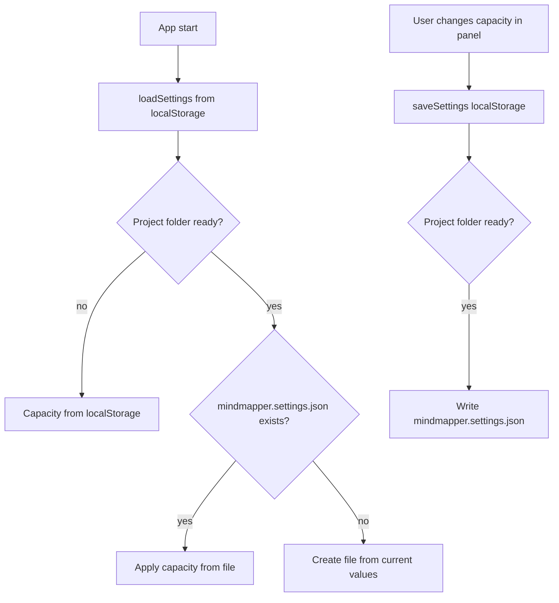

# Plan: Weekend capacity + per-folder planning settings

Target: coder executes the steps below in order. Plain JavaScript, no build step, no new script files.
All code is in the `MM` namespace (IIFE modules). Keep the existing code style (2 spaces, single quotes, `'use strict'`).

## Goal

1. Under **Planning capacity** (panel with empty selection) the user can set
   - **Hours / work day** (existing setting `hoursPerDay`)
   - **Hours / weekend day** (NEW setting `hoursPerWeekendDay`, default `0`)
   - **Work days** (existing checkboxes `workDays`). Every day that is **not** checked counts as a weekend day.
2. Workload (status bar, overview, panel preview, buffers) uses the weekend hours as capacity on non-work days.
   With `hoursPerWeekendDay = 0` the behaviour is **exactly the same as today** (backward compatible).
3. The three capacity values are stored **per project folder** in the file `mindmapper.settings.json`
   in the root of the project folder. Without an open folder they stay in localStorage (as today).
   This way one folder (instance) can be "leisure time" and another folder "work time" – no other data separation.



## Data model

`S.settings` gets one new key:

```js
hoursPerDay: 8,          // capacity of a work day
hoursPerWeekendDay: 0,   // capacity of a day that is not a work day (0 = no planning)
workDays: [1, 2, 3, 4, 5], // 0 = Sunday
```

Project file `mindmapper.settings.json` (root of the project folder):

```json
{
  "version": 1,
  "capacity": { "hoursPerDay": 8, "hoursPerWeekendDay": 0, "workDays": [1, 2, 3, 4, 5] }
}
```

Only these three keys go into the file. All other settings (grid, wheel, emoji, …) stay in localStorage.

---

## Step 1 – Default setting ([`js/state.js`](js/state.js:392))

In `MM.state.settings` add after `hoursPerDay`:

```js
hoursPerWeekendDay: 0, // capacity on days that are not work days (see workload.js)
```

## Step 2 – Capacity function ([`L.capacity()`](js/workload.js:39))

Replace it with:

```js
/** Capacity settings: { hours, weekendHours, days: [weekday numbers] }. */
L.capacity = function () {
  const h = Number(S.settings.hoursPerDay);
  const w = Number(S.settings.hoursPerWeekendDay);
  const days = Array.isArray(S.settings.workDays) ? S.settings.workDays.map(Number) : [1, 2, 3, 4, 5];
  return { hours: h > 0 && h <= 24 ? h : 8, weekendHours: w >= 0 && w <= 24 ? w : 0, days };
};

/** Base hours of a date: work day hours or weekend day hours (before days off and routines). */
L.baseHours = function (d, cap) {
  const c = cap || L.capacity();
  return c.days.includes(d.getDay()) ? c.hours : c.weekendHours;
};
```

Also update the header comment (line 18) to say: capacity = `hoursPerDay` on `workDays`, `hoursPerWeekendDay` on all other days.

## Step 3 – Workload calculation ([`L.compute()`](js/workload.js:118))

Change these parts (and nothing else in the algorithm):

1. **Planning day** = a day with base hours > 0 that is not a whole day off. Replace line 124:
   ```js
   const baseOf = (d) => L.baseHours(d, cap);
   const isWork = (d) => baseOf(d) > 0 && !(offOn(d) || {}).full;
   ```
   (`isWork` is also used by `routineOn` for the number of planning days per week → weekly budgets are now shared over weekend days with hours too. This is intended.)
2. **Capacity of a day** in `capOf` (line 137–141): replace `capDay` by `baseOf(d) * 60`:
   ```js
   return Math.max(0, baseOf(d) * 60 - (off ? off.minutes : 0) - routineOn(d));
   ```
   Keep `capDay = cap.hours * 60` in the return object (no other module uses it, but keep the key).
3. **Spreading the work** (line 161–163): spread weighted by the base hours of each day instead of evenly,
   so a weekend day with 2 h gets less than a work day with 8 h. With equal hours this is the same as before.
   ```js
   let days = dl < t0 ? [iso(t0)] : workdays(t0, dl);
   if (!days.length) days = [iso(t0)]; // due before the next planning day
   const weights = days.map((k) => baseOf(parse(k)) || 1);
   const total = weights.reduce((a, b) => a + b, 0);
   days.forEach((k, i) => byDay.set(k, (byDay.get(k) || 0) + (it.minutes * weights[i]) / total));
   ```
4. `workdays(a, b)` stays as is (it uses the new `isWork`).

The cache key in [`L.summary()`](js/workload.js:202) already contains `JSON.stringify(L.capacity())` → it changes automatically. Nothing to do there.

## Step 4 – Overview text ([`L.overviewHTML()`](js/workload.js:413))

Replace the capacity note (lines 413–416) with:

```js
const cap = L.capacity();
const names = ['Sun', 'Mon', 'Tue', 'Wed', 'Thu', 'Fri', 'Sat'];
const work = names.filter((x, i) => cap.days.includes(i)).join(', ') || 'none';
const rest = names.filter((x, i) => !cap.days.includes(i)).join(', ');
notes.push(`Capacity: ${cap.hours} h per work day (${work})` +
  (rest ? `, ${cap.weekendHours} h per weekend day (${rest})` : '') +
  ` – stored ${MM.storage.capacityLocation()}. Change it in the panel (click the empty canvas). ` +
  'Work is spread over the planning days until its deadline.');
```

`MM.storage.capacityLocation()` is created in step 6.

## Step 5 – Panel UI ([`canvasPanel()`](js/panel.js:273))

Replace the `Planning capacity` section with:

```js
<section><h3>Planning capacity</h3>
  <div class="row"><label>Hours / work day</label><input type="number" data-setting="hoursPerDay" value="${esc(MM.load.capacity().hours)}" min="0.5" max="24" step="0.5"></div>
  <div class="row"><label>Hours / weekend day</label><input type="number" data-setting="hoursPerWeekendDay" value="${esc(MM.load.capacity().weekendHours)}" min="0" max="24" step="0.5"></div>
  <div class="row col"><label>Work days</label><div class="workdays">${...unchanged checkbox code...}</div></div>
  <p class="hint">Unchecked days are weekend days. 0 h per weekend day = no planning on those days.
    Used for the workload in the status bar and the overview. Stored ${esc(MM.storage.capacityLocation())}.</p>
</section>
```

In [`onChange` / setting handler](js/panel.js:401):

- In the `ds.workday` branch: after `MM.saveSettings();` add `MM.storage.saveProjectSettings();`.
  Also fix the sort to be numeric: `[...days].sort((a, b) => a - b)`.
- In the `ds.setting` branch: after `MM.saveSettings();` add
  ```js
  if (MM.storage.CAPACITY_KEYS.includes(ds.setting)) MM.storage.saveProjectSettings();
  ```
- Check that `parseValue` returns a number for `type="number"` (it does for `hoursPerDay` already). `0` must be accepted for `hoursPerWeekendDay` – verify that line 357 (`!isFinite(value)`) does not reject `0` (it does not) and that no `min`-clamp elsewhere turns `0` into something else.

## Step 6 – Per-folder storage ([`js/storage.js`](js/storage.js:31))

Add to the settings section of `storage.js`:

```js
ST.PROJECT_SETTINGS_FILE = 'mindmapper.settings.json';
ST.CAPACITY_KEYS = ['hoursPerDay', 'hoursPerWeekendDay', 'workDays'];
const projectReady = () => !!(MM.project && MM.project.status === 'ready' && MM.project.dir);

/** Where the capacity is stored (for hints in the UI). */
ST.capacityLocation = () => (projectReady()
  ? `in the folder "${MM.project.dir.name}" (${ST.PROJECT_SETTINGS_FILE})`
  : 'in this browser');

/**
 * Read the capacity of the open project folder and apply it.
 * No file yet: create it from the current values (first use of the folder).
 */
ST.loadProjectSettings = async function () {
  if (!projectReady()) return;
  const fh = await MM.project.getHandle(ST.PROJECT_SETTINGS_FILE);
  if (!fh) {
    await ST.saveProjectSettings();
    return;
  }
  try {
    const data = JSON.parse(await (await fh.getFile()).text());
    const c = (data && data.capacity) || {};
    for (const k of ST.CAPACITY_KEYS) if (c[k] !== undefined) S.settings[k] = c[k];
  } catch (e) {
    console.warn('MindMapper: unreadable ' + ST.PROJECT_SETTINGS_FILE, e);
  }
};

/** Write the capacity into the project folder (no-op without folder). */
ST.saveProjectSettings = async function () {
  if (!projectReady()) return;
  const capacity = {};
  for (const k of ST.CAPACITY_KEYS) capacity[k] = S.settings[k];
  try {
    await MM.project.writeText(ST.PROJECT_SETTINGS_FILE, JSON.stringify({ version: 1, capacity }, null, 2));
  } catch (e) {
    console.warn('MindMapper: could not write ' + ST.PROJECT_SETTINGS_FILE, e);
  }
};
```

Notes:
- `MM.project.getHandle()` returns `null` if the file does not exist (see [`P.getHandle()`](js/project.js:154)).
- `MM.project.writeText()` exists already ([`P.writeText()`](js/project.js:175)).
- Values from the file are validated by `L.capacity()` anyway, no extra validation needed.
- `MM.saveSettings()` keeps writing everything to localStorage (fallback when no folder is open). Do not change it.

## Step 7 – Hook into the project folder ([`js/project.js`](js/project.js:74))

1. In [`connected()`](js/project.js:74), right after `P.status = 'ready';` and **before** `await P.scan();`:
   ```js
   await MM.storage.loadProjectSettings(); // capacity of this folder (leisure / work instance)
   ```
   `connected()` already calls `MM.ui.update()` afterwards; the workload cache key changes, so status bar and panel refresh. If the panel does not refresh, add `MM.panel.update(true);` after `MM.ui.update();`.
2. In [`list()`](js/project.js:123), the settings file must **not** appear as a map (all `.json` files are listed). Add at the top of the loop, after the `name.startsWith('.')` check:
   ```js
   if (depth === 0 && h.kind === 'file' && name === MM.storage.PROJECT_SETTINGS_FILE) continue;
   ```
   This also keeps it out of `P.mapPaths()` → workload, overview and link suggestions ignore it.
3. [`P.choose()`](js/project.js:47) (switching to another folder) goes through `connected()` → the capacity of the new folder is loaded automatically. Nothing else to do.

## Step 8 – Documentation

- [`HANDBUCH.md`](HANDBUCH.md:124): replace the line **Kapazität** with:
  - **Kapazität:** Panel bei leerer Auswahl → **Planning capacity**: *Hours / work day*, *Hours / weekend day* und die Arbeitstage (nicht angehakte Tage = Wochenendtage; 0 h = dort wird nichts eingeplant). Standard: 8 h Mo–Fr, 0 h am Wochenende.
  - Die Kapazität wird **pro Projektordner** in `mindmapper.settings.json` gespeichert. So kann ein Ordner die Freizeit planen (z. B. 3 h werktags, 8 h am Wochenende) und ein anderer Ordner die Arbeitszeit (8 h werktags, 0 h am Wochenende). Ohne geöffneten Ordner gilt die Einstellung des Browsers.
  - Arbeit wird auf alle Tage mit Kapazität bis zur Deadline verteilt, gewichtet nach den Stunden des Tages.
- In HANDBUCH line 116–117 replace "Arbeitstage" by "Planungstage (Tage mit Kapazität)" and "Stunden pro Tag" by "Stunden des Tages (Werktag oder Wochenende)".
- [`plans/feature-plan.md`](plans/feature-plan.md:274): update the capacity line (`settings.hoursPerWeekendDay`, file `mindmapper.settings.json`).

## Step 9 – Manual test checklist

Open `index.html` in Edge/Chrome.

1. **No folder open:** set Hours / weekend day = 0 → status bar and overview identical to before the change.
2. Set weekend = 4 h → overview "Weeks" capacity grows by 8 h per full week; Sat/Sun rows appear in "Days" with 4 h.
3. A note with estimate 12 h and deadline next Monday (today = Friday, weekend 4 h, workday 8 h): weights 8/4/4/8 (sum 24) → overview shows Fri 4 h, Sat 2 h, Sun 2 h, Mon 4 h.
4. Uncheck all work days, weekend 2 h → every day has 2 h; no division by zero, no NaN anywhere.
5. Weekly budget routine (e.g. 5 h/week) → shared over all planning days incl. weekend days with hours.
6. Whole day off on a Saturday with weekend hours → Saturday capacity 0.
7. **Open folder A** (no settings file yet) → `mindmapper.settings.json` is created with the current values; it does **not** appear in the project sidebar, overview or workload.
8. Change capacity in folder A → file content updates. Open folder B → its own file is created/loaded; values switch. Back to folder A → A's values return.
9. Reload the page with folder A connected → A's values are used (not the localStorage ones).
10. Corrupt the JSON file by hand → app still works (warning in console, previous values kept).
