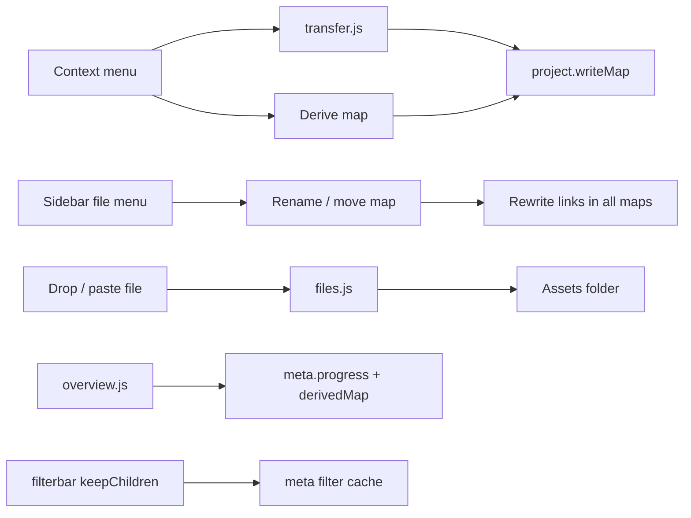

# MindMapper – Feature-Plan (9 Erweiterungen)

Dieser Plan wird von Code-Mode umgesetzt. Grundregel des Projekts bleibt: **Modell in `MM.state.doc` ändern → `MM.commit()`**. Keine Build-Tools, keine ES-Module, alles über `window.MM`. UI-Texte bleiben Englisch (wie im Bestand).

## Umsetzungsstand (Code-Review vom 21.10.2026)

Alle neun Features sind im Code vorhanden. Die Tabelle nennt, was gegenüber dem Plan fehlt oder anders gelöst ist.

| # | Feature | Stand | Abweichungen / offen |
|---|---|---|---|
| 0 | Infrastruktur (`getHandle`, `ensureDir`, `writeMap`, `ensureMap`, `createMap({open})`) | ✅ fertig | Map-Picker heißt `MM.transfer.pickMap` (nicht `MM.mapPicker.pick`), nur flache Liste mit Suche und Schnellwahl, **kein Ordnerbaum und kein „New map…“**. `markMoved()` schreibt weiter direkt statt über `P.writeMap`. `transfer.js` wird nach `project.js` geladen (funktioniert, weil alles erst zur Laufzeit aufgelöst wird). |
| 1 | Maps umbenennen / verschieben | ✅ fertig | Zusätzlich „Delete map…“ im Kontextmenü. Der optionale ⋯-Hover-Button fehlt. Unterordner-Bug R6 behoben. |
| 2 | Tages-Mindmaps | ✅ fertig | Neu (21.10.2026): Carry-over erst, wenn der Tag / die Woche / der Monat der neuen Map begonnen hat (`T.hasStarted`). Vorab angelegte Maps bekommen `doc.carriedOver = false` und fragen beim ersten Öffnen ab Beginn ihres Zeitraums einmal nach (`P.offerCarry`). Gilt für „New map“-Dialog, Links auf fehlende Maps und `P.ensureMap` (Move to map, abgeleitete Maps). Dabei behoben: `ensureMap` hat übertragene Einträge in der alten Map nicht als „moved“ markiert. |
| 3 | Datennotes | ✅ fertig | Zusätzlich: Rechteabfrage vor dem Schreiben (`ensureWriteAccess`), fehlende Datei neu wählen, `Assets/` wird beim Scan übersprungen. Öffnen per Einfachklick aufs Icon statt Doppelklick. HTML/SVG/XML werden aus Sicherheitsgründen heruntergeladen statt angezeigt (R3). |
| 4 | Filter „Keep sub-notes“ | ✅ fertig | Cache über `S.rev` wie geplant. |
| 5 | Map aus Note ableiten | ✅ fertig | Kein klickbares Map-Badge, nur gestrichelter Rahmen (`.node.has-map`). Öffnen geht über Kontextmenü und ↗. |
| 6 | Fortschritt (%) | ✅ fertig | Status ↔ Fortschritt liegt zentral in `MM.meta.setValue` (Panel, Kontextmenü, Chips). Neu (21.10.2026): Klick auf einen Metadaten-Chip einer Task öffnet ein Dropdown direkt am Chip (`MM.menu.openMeta`): Status, Priorität, Deadline (Schnellwahl + Datumsauswahl), Schätzung, Fortschritt; „More in panel…“ springt wie früher ins Panel. |
| 7 | Overview erweitern | ✅ fertig | „Map not found“ für gelöschte abgeleitete Maps ✅ (21.10.2026). Durchschnittsfortschritt pro Gruppe fehlt (war optional). |
| 8 | Note in andere Map übertragen | ✅ fertig | Hinweisnote wird über `movedHintId` beim Undo mit entfernt. Badge „→ 2026-W44“ ✅ (21.10.2026, Klick öffnet die Ziel-Map). „Move to map“ bleibt bei bereits übertragenen Notes klickbar (nur Label ändert sich). Bugs R4/R5 behoben. |
| 9 | Emoji / Symbole | ✅ fertig | `Ctrl+Shift+E` und der optionale Toolbar-Button ☺ fehlen. |
| 10 | Task-Hierarchie in der Overview | ✅ fertig (21.10.2026) | Siehe Abschnitt „Feature 10“. |
| 11 | Automatische Darstellungen + Auto-Layout | ✅ fertig (21.10.2026) | Siehe Abschnitt „Feature 11“. |
| 12 | Auslastung (verplante Stunden, Puffer) | ✅ fertig (21.10.2026) | Siehe Abschnitt „Feature 12“. |
| 13 | Routinen (regelmäßige Aufgaben) | ✅ fertig (21.10.2026) | Siehe Abschnitt „Feature 13“. |
| – | Querschnitt (`normalizeDoc`, `index.html`, README) | ✅ fertig | Manueller Gesamttest (siehe Abschluss) noch offen. |

## Review-Befunde (Schwachstellen)

Sortiert nach Schwere. **R1–R6 und R8 sind seit dem 21.10.2026 behoben** (Vermerk „✅ behoben“). R7 und R9 sind offen.

**R1 – Hoch: Datenverlust beim Arbeiten an zwei Rechnern.** ✅ behoben: `relinkRestored()` in `project.js` lädt die Datei, wenn sie neuer als die Autosave-Kopie ist (bei ungespeicherten lokalen Änderungen wird gefragt). Beim Start lädt [`storage.js`](../js/storage.js) `restoreAutosave()` die letzte lokale Kopie aus dem Browser. Sobald der Projektordner verbunden ist, hängt `connected()` in [`project.js`](../js/project.js) diese Kopie wieder an ihre Datei (`restoredPath`), **ohne zu prüfen, ob die Datei auf der Platte neuer ist**. Die nächste Änderung (oder schon ein Map-Wechsel bei `dirty`) überschreibt die Datei mit dem alten Stand. Typischer Fall: Projektordner per OneDrive o. Ä. synchronisiert, zu Hause weitergearbeitet, im Büro geöffnet → die Arbeit von zu Hause ist weg.
*Fix:* Beim Wiederverknüpfen `(await handle.getFile()).lastModified` mit `autosave.time` vergleichen. Ist die Datei neuer, die Datei laden (bzw. fragen, falls die lokale Kopie `dirty` war).

**R2 – Mittel: Script-Injection über präparierte Map-Dateien.** ✅ behoben: `normalizeDoc` erzwingt Zahlen, prüft Typ, Form, Status, Priorität und Kantenstil gegen die Kataloge und lässt nur `data:image/`-Assets zu. Die genannten Stellen escapen zusätzlich. `MM.normalizeDoc()` übernimmt Felder ungeprüft, und an einigen Stellen landen sie unescaped in `innerHTML`:
- [`panel.js`](../js/panel.js) Zeilen 90, 104, 109: `st.opacity`, `st.strokeWidth`, `st.fontSize` in `value="…"`
- [`overview.js`](../js/overview.js) Zeile 134: `n.type` in `<option value="${t}">` (die Overview liest sogar **alle** Maps des Ordners, ohne sie zu normalisieren)
- [`render.js`](../js/render.js) Zeile 490: `an.x/y/w/h` im Overlay-SVG

Eine fremde `.mindmap.json` (oder eine Datei im synchronisierten Ordner) kann damit Code im App-Kontext ausführen, inklusive Zugriff auf den gespeicherten Ordner-Handle.
*Fix:* In `normalizeDoc` Zahlenfelder (`x, y, w, h`, Style-Zahlen, `meta.progress`, `meta.estimate`) per `Number()` erzwingen und `type`/`shape` gegen die Kataloge prüfen. Die betroffenen Stellen zusätzlich mit `esc()` absichern. `P.readMap` sollte immer `MM.normalizeDoc` zurückgeben.

**R3 – Mittel: HTML-/SVG-Dateien aus `Assets/` laufen im App-Kontext.** ✅ behoben: `html`, `svg` und `xml` werden heruntergeladen statt inline geöffnet. [`files.js`](../js/files.js) `F.open()` öffnet `html`, `htm`, `svg` und `xml` als `blob:`-URL. Diese erbt den Ursprung der App, eingebettete Scripts könnten also auf IndexedDB (Ordner-Handle) und localStorage zugreifen.
*Fix:* Diese Endungen aus `INLINE` entfernen (Download), oder den Blob als `text/plain` neu verpacken.

**R4 – Mittel (Bug): „Undo move“ löscht fremde Verbindungen.** ✅ behoben. [`transfer.js`](../js/transfer.js) Zeile 284 entfernt jede Kante, deren `source.node`/`target.node` nicht existiert. Kanten mit freiem Ende haben gar kein `node` und werden in der Ziel-Map mit gelöscht.
*Fix:* Wie in `A.deleteSelection` nur prüfen, wenn das Ende gebunden ist: `(e.source.node && !doc.nodes[e.source.node]) || …`.

**R5 – Mittel (Bug): Übertragene Bilder werden leer.** ✅ behoben. `T.move()` kopiert Bild-Notes, aber nicht `S.doc.assets[imageId]` in `doc.assets` der Ziel-Map (Plan-Schritt 1 fehlt). Ergebnis: „Image missing“.
*Fix:* Vor `writeMap` die Assets der kopierten Bild-Notes übernehmen (wie in `A.copy`).

**R6 – Niedrig (Bug): Unterordner beim Umbenennen/Verschieben.** ✅ behoben: neuer Helfer `P.sanitizeFolder`, auch im „New map“-Dialog. `P.sanitizeName` ersetzt `/`, der Ordner im Rename-Dialog und bei „New folder…“ wird dadurch flach. Die Datalist schlägt aber verschachtelte Ordner vor.
*Fix:* Ordner segmentweise säubern (`split('/').map(P.sanitizeName).filter(Boolean).join('/')`).

**R7 – Niedrig: Gleichzeitiges Schreiben.** Transfer, Rename-Linkpflege und Autosave schreiben ohne Prüfung in Map-Dateien. Ist dieselbe Map in einem zweiten Tab oder auf einem zweiten Rechner offen, gewinnt der letzte Schreiber. Zusammen mit R1 lösen: vor dem Schreiben `lastModified` mit dem Stand beim Laden vergleichen und bei Abweichung warnen.

**R8 – Niedrig: Robustheit bei kaputten Dateien.** ✅ behoben: `P.readMap` normalisiert jetzt. `P.readMap` liefert rohes JSON. Eine Map ohne `nodes` oder mit `items[].text = null` lässt Overview (`i.text.trim()`) bzw. `T.move` (`doc.nodes[...] =`) abstürzen. Wird mit dem Fix aus R2 (normalisieren in `readMap`) mit erledigt.

**R9 – Info:** Inline geöffnete Dateien behalten ihre `blob:`-URL bis zum Schließen der Seite (Speicher). Die Meldung in `F.insertFiles` („opened from disk (not file://)“) widerspricht der README („double-click `index.html`“).

## Nächste Schritte

1. R1 und R5 im echten Browser mit Projektordner testen (headless nicht prüfbar, weil der Projektordner-Zugriff im Browser nötig ist). Für R1: Map auf Rechner A ändern, Sync abwarten, auf Rechner B öffnen → der Stand von A muss erscheinen.
2. R7 (Schreibkonflikte) angehen.
3. Offene Plan-Punkte nach Bedarf: Map-Picker mit Ordnerbaum und „New map…“, „Map not found“ in der Overview, Badges für `derivedMap`/`movedTo`, `Ctrl+Shift+E`.
4. Manueller Gesamttest aus dem Abschnitt „Querschnitt / Abschluss“.

## Entscheidungen (mit dem Nutzer geklärt)

- **Unternotes (Filter):** verbundene Nachfahren in Pfeilrichtung (source → target, rekursiv) **und** Notes innerhalb einer passenden Gruppe.
- **Datennotes:** Datei wird in den Projektordner nach `Assets/` kopiert; die Note verlinkt relativ darauf. Klick öffnet die Datei im Browser, wenn sie anzeigbar ist, sonst wird sie heruntergeladen.
- **Note in andere Map übertragen:** wie beim Carry-over. Das Original bleibt ausgegraut (`movedTo`) mit Link zur Ziel-Map stehen und zählt nirgends mehr; aktiv ist nur die Kopie.

## Architektur-Überblick

## Neue/geänderte Datenfelder

| Feld | Wo | Bedeutung |
|---|---|---|
| `meta.progress` | Node | `null` oder Zahl 0–100 (Fortschritt in %) |
| `movedTo` | Node | existiert schon: Pfad der Ziel-Map, Original zählt nicht mehr |
| `movedFrom` | Node | **neu:** Pfad der Quell-Map an der übertragenen Kopie |
| `derivedMap` | Node | **neu:** Pfad einer aus dieser Note erzeugten Map |
| `file` | Node vom Typ `file` | **neu:** `{ path, name, size, mime }`, `path` relativ zum Projektordner, z. B. `Assets/report.xlsx` |
| `filter.keepChildren` | `MM.state.filter` | **neu:** Unternotes passender Notes sichtbar lassen |

`MM.normalizeDoc()` in [`js/state.js`](../js/state.js) muss alle neuen Felder für ältere Dateien auffüllen.

---

## Phase 0 – Gemeinsame Infrastruktur in `js/project.js`

Mehrere Features schreiben in Maps, die gerade **nicht** geöffnet sind. Dafür einmal zentrale Helfer bauen:

- `P.getHandle(path, { create, kind })`: läuft per `getDirectoryHandle`/`getFileHandle` durch den Pfad. Wichtig: `P.find()` kennt nur `.json`-Dateien, für `Assets/` reicht das nicht.
- `P.ensureDir(folder)`: legt Ordnerketten an (Logik aus `createMap` herauslösen).
- `P.writeMap(path, doc)`: Ist `path === S.file.path`, dann `S.doc` ersetzen bzw. mutieren, `MM.commit()` und `MM.storage.writeFile()` aufrufen. Sonst JSON in den Handle schreiben. `markMoved()` in project.js nutzt diesen Helfer danach.
- `P.ensureMap(path)`: Map aus `MM.templates.forPath(path)` anlegen, falls sie fehlt, **ohne** sie zu öffnen. Rückgabe: der Pfad.
- `P.createMap()` soll den erzeugten Pfad zurückgeben und optional `{ open: false }` akzeptieren.
- Map-Auswahldialog `MM.mapPicker.pick({ title, suggestions })` → Promise mit Pfad oder `null`. Inhalt: Suchfeld, Schnellwahl-Buttons (z. B. „Next week“), Ordnerbaum aller `P.mapPaths()` und „New map…“ (Name + Ordner). Lebt in der neuen Datei `js/transfer.js`.
- Alle Map-Features prüfen `P.status === 'ready'`. Falls nicht: Hinweis „Open the project folder first“.

## Feature 1 – Maps umbenennen und verschieben

Dateien: [`js/project.js`](../js/project.js), [`css/app.css`](../css/app.css)

- Rechtsklick auf `.sb-file` in der Sidebar (eigener `contextmenu`-Listener, nutzt `MM.menu.open`) mit den Einträgen „Rename…“ und „Move to folder…“. Optional einen kleinen ⋯-Button beim Hover einblenden.
- Dialog: Name plus Ordner (Datalist aus `allFolders()`, neuer Ordner erlaubt). Ungültige Zeichen wie in `showNewDialog` ersetzen und `.mindmap.json` anhängen.
- `P.renameMap(oldPath, newPath)`:
  1. Abbrechen, wenn das Ziel schon existiert.
  2. Ist die Map offen: vorher `MM.storage.writeFile()`.
  3. Inhalt lesen, neue Datei schreiben, alte per `parentDir.removeEntry(name)` löschen. Kein `handle.move()`, das ist nicht in allen Browsern zuverlässig.
  4. Ist die Map offen: `S.file.handle`, `S.file.path` und `S.file.name` aktualisieren.
  5. `P.history`-Einträge umschreiben.
  6. **Verweise in allen Maps umschreiben:** `link`, `movedTo`, `movedFrom` und `derivedMap` (exakter Pfadvergleich). Bei To-do-Items `it.moved` (Label = alter Name) auf das neue Label setzen. Die offene Map über `MM.commit()` ändern, die übrigen über `P.writeMap`.
  7. `P.scan()` aufrufen und „Renamed …“ flashen.
- Hinweis im Dialog: Wochen-, Monats- und Tagesmaps verlieren ihre automatische Verknüpfung (Vorlagen-Links), wenn das Namensschema `2026-W43` / `2026-10` / `2026-10-20` verlassen wird.

## Feature 2 – Tages-Mindmaps

Dateien: [`js/templates.js`](../js/templates.js), [`js/project.js`](../js/project.js)

- `T.DAY_FOLDER = 'Days'`, `T.dayValue(d)` → `YYYY-MM-DD`, `T.parseDay(s)` und `T.dayPath(d)`.
- `T.day(date)` baut über `plan()` eine Map mit der Überschrift „Tuesday, 20 Oct 2026“. Die Überschrift verlinkt auf `T.weekPath(date)`. Spalten (alle To-do): „Morning“, „Afternoon“, „Evening“, jeweils mit `meta.deadline = Datum`. Ziele links und Notizen rechts kommen wie gewohnt aus `plan()`.
- `T.week()`: Jede Tagesspalte bekommt `extra.link = T.dayPath(d)` (Klick ↗ öffnet bzw. erzeugt die Tagesmap).
- `T.forPath()`: Muster `YYYY-MM-DD` → `{ kind: 'day', prevName: Vortag }`. Die Prüfung muss **vor** `parseMonth` stehen. Dadurch funktioniert Carry-over vom Vortag automatisch über `openLinked` und den Dialog.
- Neue-Map-Dialog: Chip „Day plan“ mit `<input type="date">`. `suggestion()` und `sync()` entsprechend erweitern.

## Feature 3 – Datennotes (Dateien reinziehen)

Neue Datei `js/files.js` (in [`index.html`](../index.html) nach `images.js` laden), dazu Änderungen in [`js/state.js`](../js/state.js), [`js/render.js`](../js/render.js), [`js/interaction.js`](../js/interaction.js), [`js/contextmenu.js`](../js/contextmenu.js), [`js/actions.js`](../js/actions.js) und [`css/app.css`](../css/app.css).

- Neuer Typ `file` in `MM.NODE_TYPES` (Label „File“). Er wird aus `MM.TEXT_TYPES` ausgeschlossen, genau wie `image`. Preset: `w: 240, h: 64`, Form `rounded`, eigene Farbe. `MM.setNodeType` blockiert den Wechsel von und zu `file`.
- Bestandteile von `MM.files`:
  - `F.insertFiles(files, at)`: Ohne bereiten Projektordner Hinweis zeigen und abbrechen. Sonst `Assets/` anlegen, eindeutigen Dateinamen wählen (`name (2).xlsx`), Datei per `createWritable` schreiben, Note mit `file: { path, name, size, mime }` und `text = Dateiname ohne Endung` anlegen, dann `MM.commit()`.
  - `F.open(node)`: Handle über `P.getHandle(path)` holen, dann `getFile()` und `URL.createObjectURL`. Anzeigbare Typen (pdf, txt, csv, json, md, Bilder, html, Audio/Video) per `window.open` öffnen, alles andere über `<a download>`. Fehlt die Datei: „File not found: …“.
  - `F.icon(name)`: SVG bzw. Kürzel je Endung (XLS, DOC, PDF, CSV, ZIP, …).
- Drop und Paste in [`js/interaction.js`](../js/interaction.js): Bilder laufen weiter über `MM.images`, **alle anderen** Dateien über `MM.files.insertFiles`. Gemischte Drops aufteilen.
- Darstellung in `R.buildContent`: Icon, Titel (editierbar, `data-field="text"`), Untertitel mit Dateiname und Größe. Im `contentKey` das Feld `n.file` mitführen.
- Öffnen per Doppelklick auf das Icon, über den ↗-Button oder Ctrl+Klick (analog zu `n.link`, also `node-linkbtn` auch bei `n.file` anzeigen). Kontextmenü: „Open file“, „Replace file…“ und „Reveal path“ (Pfad flashen).
- „Insert“-Menü: Eintrag „File…“ öffnet einen Datei-Picker (`input type=file`, `multiple`).
- Kopieren und Einfügen behält den Pfad bei, es wird keine neue Datei kopiert. Beim Löschen der Note bleibt die Datei bestehen (nicht destruktiv). Das in der README dokumentieren.
- Overview und Filter: Typ „File“ taucht automatisch über `MM.NODE_TYPES` auf.

## Feature 4 – Filter: Unternotes sichtbar lassen

Dateien: [`js/meta.js`](../js/meta.js), [`js/filterbar.js`](../js/filterbar.js), [`js/state.js`](../js/state.js)

- `S.filter.keepChildren = false` (Default).
- `META.visibleSet()` berechnet einmal pro Render:
  1. `matched` = alle Notes mit `META.matches(n)`.
  2. Ist `keepChildren` aktiv, BFS ab `matched`: über `edges`, bei denen `source.node` in der Menge liegt, zu `target.node` (nur gebundene Enden, Zyklen über ein Visited-Set abfangen). Für jede Gruppe in der Menge kommen die `MM.interaction.groupMembers(g)` dazu. Wiederholen, bis nichts Neues mehr hinzukommt, weil eine Gruppe in der Nachfahrenkette selbst Mitglieder hat.
- Cache-Schlüssel: `JSON.stringify(S.filter)` plus ein Doc-Revisionszähler, der in `MM.commit()` hochgezählt wird. Alternativ einfach in `R.all()`/`MM.refresh()` am Anfang berechnen und in `META._visible` ablegen.
- `META.filteredOut(n)` = `filterActive() && !visibleSet().has(n.id)`. `matches()` bleibt unverändert für die Zählung „x of y“. Die Zählung soll dann „x matching (+k sub-notes)“ anzeigen.
- In der Filterbar ein Checkbox-Chip „Keep sub-notes“ mit Tooltip: „Notes connected below a match (arrow direction) and notes inside a matching group stay visible“.
- Leistung: Drag-Rendering ruft `filteredOut` pro Node auf, deshalb ist der Cache Pflicht.

## Feature 5 – Neue Mindmap aus einer Note ableiten

Dateien: [`js/contextmenu.js`](../js/contextmenu.js), [`js/actions.js`](../js/actions.js), [`js/project.js`](../js/project.js)

- Kontextmenü (eine einzelne Note, kein Bild): „Create map from note…“. Hat die Note schon `derivedMap`, stattdessen „Open derived map ↗“.
- `A.deriveMap()`: Dialog mit Name (Default: erste Zeile von `n.text`, ungültige Zeichen ersetzt) und Ordner (Default: Ordner der aktuellen Map).
- Inhalt der neuen Map über `T.blank(title)`: Die Überschrift trägt den Titel und `link` zurück auf die Quell-Map. Bei Task-, Outline- und To-do-Notes zusätzlich eine Kopie der Quellnote (Blöcke bzw. Items) unter der Überschrift einfügen, als Startpunkt.
- In der Quellnote `n.derivedMap = newPath` setzen und `n.link` nur dann, wenn er leer ist. Danach `MM.commit()` und `writeFile()`, anschließend die neue Map öffnen (`P.createMap` → `openMap`).
- Render: Noten mit `derivedMap` bekommen ein kleines Map-Badge; ein Klick darauf öffnet die Map.

## Feature 6 – Fortschritt (%) für Task Notes

Dateien: [`js/state.js`](../js/state.js), [`js/meta.js`](../js/meta.js), [`js/panel.js`](../js/panel.js), [`js/render.js`](../js/render.js), [`css/app.css`](../css/app.css)

- `MM.emptyMeta()` bekommt `progress: null`.
- Panel → Details: Zeile „Progress“ mit `range` 0–100 (Schritt 5) und Zahlenfeld, nur wenn alle ausgewählten Notes Tasks sind. Dazu ein ×-Button zum Leeren. Die Live-Vorschau läuft über den bestehenden `onInput`-Pfad (Werte als Zahl parsen und clampen).
- `chipsHTML`: Chip „▰ 40 %“ mit `data-meta="progress"`. In Task-Notes als Platzhalter „Progress“. Unter dem Task-Titel ein dünner Fortschrittsbalken.
- Kopplung an den Status: progress = 100 → `status = 'done'` vorschlagen bzw. setzen; status = done → progress 100 anzeigen. Umsetzung: In `apply()` bei `ds.meta === 'progress'` auf 100 automatisch `status='done'` setzen, wenn vorher nicht done. Bei progress > 0 und Status `none`/`open` → `progress`.
- `META.hasAny` und `META.matches` berücksichtigen `progress`. Optionaler Filter ist nicht nötig.

## Feature 7 – Overview erweitern

Datei: [`js/overview.js`](../js/overview.js) (+ CSS)

- Neues Select „Any type“ plus alle `MM.NODE_TYPES`, die vorkommen; `view.type`, Filter in `render()`.
- Item um `type`, `progress` und `derivedMap` erweitern. Für To-do-Notes kann `progress` aus done/filled berechnet werden, Anzeige ist optional.
- Zeile: Bei Tasks den Fortschrittsbalken plus %-Wert (eigene Spalte, `grid-template-columns` anpassen). Hat die Note `derivedMap`, einen Button „🗺 Map“ (`data-open-map`): Klick → `dialog.close()` und `MM.project.openMap(derivedMap)`, mit `stopPropagation`, damit nicht die Quellnote fokussiert wird.
- Existiert die abgeleitete Map nicht mehr (`P.find`), den Button ausgegraut mit Tooltip „Map not found“ zeigen.
- Gruppen-Summe: zusätzlich durchschnittlicher Fortschritt der Tasks in der Gruppe (optional).
- Übertragene Originale (`movedTo`) bleiben ausgeschlossen (bestehende Logik); die Kopie mit `movedFrom` wird normal gelistet.

## Feature 8 – Note in andere Map übertragen

Neue Datei `js/transfer.js` (nach `templates.js`, vor `project.js` laden, oder Map-Picker und Transfer gemeinsam nach `project.js`), dazu [`js/contextmenu.js`](../js/contextmenu.js), [`js/render.js`](../js/render.js), [`js/overview.js`](../js/overview.js) und [`js/templates.js`](../js/templates.js).

- Kontextmenü auf eine oder mehrere ausgewählte Notes: „Move to map…“ mit Untermenü:
  - Schnellwahl abhängig vom Typ der aktuellen Map (`T.forPath(S.file.path).kind`): Tag → „Next day“, Woche → „Next week“, Monat → „Next month“. Zusätzlich immer „Today“ und „This week“, falls nicht die aktuelle Map.
  - „Other map…“ → `MM.mapPicker.pick()`.
- `MM.transfer.move(nodeIds, targetPath)`:
  1. Notes mit `movedTo` überspringen (schon übertragen) und Bilder einschließlich Asset kopieren (Asset-Daten mitnehmen wie in `A.copy`).
  2. Ziel über `P.ensureMap()` anlegen (Vorlagen und Carry-over wie bei `openLinked`), dann `P.readMap()`.
  3. Kopien erzeugen: neue IDs für Note, Items und Blöcke. `movedFrom = S.file.path` setzen, `movedTo` entfernen, Tag `carried-over` **nicht** zwingend (nur `movedFrom`-Hinweis). Verbindungen zwischen mitübertragenen Notes mitkopieren.
  4. Platzierung in der Ziel-Map: unter dem untersten Node, mit einem Hinweistext „Moved from <label>“, wenn noch nicht vorhanden (Logik aus `addCarryOver` als `T.placeBelow(doc, nodes)` wiederverwenden).
  5. `P.writeMap(targetPath, doc)`.
  6. Originale markieren: `n.movedTo = targetPath`, `n.link ||= targetPath`, danach `MM.commit()`.
- Verhindern von Doppellistung:
  - Overview und `collectUnfinished` ignorieren `movedTo` schon jetzt, das ist ausreichend.
  - Filter und Zählung: Notes mit `movedTo` als „moved“ ausgrauen (CSS `.node.moved` existiert bereits). Optional zeigt ein Badge „→ 2026-W44“ das Ziel; Klick öffnet die Map.
  - Erneutes Übertragen einer Note mit `movedTo` ist nicht erlaubt (Menüeintrag deaktiviert, Tooltip „Already moved to …“).
  - „Undo move“ im Kontextmenü eines Originals mit `movedTo`: Kopie in der Ziel-Map entfernen (über `movedFrom` plus Text/Typ-Vergleich bzw. eine gespeicherte `copyId`) und `movedTo` zurücksetzen. Dafür beim Übertragen am Original `movedCopyId` speichern.
- To-do-Einträge (einzelne Items) werden **nicht** über diesen Weg übertragen. Übertragen wird die ganze Note; einzelne Items laufen weiter über Carry-over.

## Feature 9 – Emoji/Symbole einfügen

Neue Datei `js/emoji.js` (nach `editing.js` laden), dazu [`js/contextmenu.js`](../js/contextmenu.js), [`js/actions.js`](../js/actions.js), [`js/interaction.js`](../js/interaction.js), [`css/app.css`](../css/app.css).

Emoji sind normale Unicode-Zeichen. Sie brauchen **keine** Modelländerung, sie landen einfach in `n.text`. Dadurch funktionieren Kopieren, Undo, Speichern und Filtern automatisch.

- `MM.emoji` mit kuratierter Liste je Kategorie: `smileys` (😀 😄 😂 🙂 😉 😍 🤔 😴 😎 🥳 …), `gestures` (👍 👎 👏 🙌 🤝 ✌️ …), `symbols` (✅ ❌ ⚠️ ❗ ❓ ⭐ 🔥 💡 📌 🎯 …), `objects` (📁 📄 📊 📈 🗓️ 📝 🔗 💻 🔧 …), `activity`, `food`, `travel`, `animals` und `flags`. Pro Eintrag `{ char, keywords }` für die Suche (englische Stichwörter, z. B. `check, done, ok`). Rund 300 Einträge reichen.
- `E.pick(anchor)` → Promise mit dem gewählten Zeichen oder `null`. Popover (kein modaler Dialog), im `#ui-layer` positioniert und am Fensterrand geklemmt, mit Suchfeld, Kategorie-Tabs, Raster aus Buttons und einer Zeile „Recent“. Escape und Klick außerhalb schließen. Die letzten 20 Zeichen liegen in `S.settings.emojiRecent` (Array) und werden über `MM.saveSettings()` gespeichert.
- `E.insertText(str)`: Läuft gerade eine Textbearbeitung (`MM.editing`), dann `document.execCommand('insertText', false, str)` an der aktuellen Caret-Position. Das erhält die native Undo-Historie des Feldes, und `ED.finish()` schreibt den Wert wie gewohnt zurück. Ist keine Bearbeitung aktiv, wird nichts eingefügt und `false` zurückgegeben.
- `E.appendTo(node, str)`: Hängt das Zeichen mit führendem Leerzeichen an `node.text` an und ruft `MM.commit()`. Das ist der Fallback ohne Caret.
- `E.insertNote(str, at)`: Legt eine `text`-Note mit `shape: 'none'`, `fontSize: 40`, `w/h` ca. 72/72 und `text = str` an, zentriert auf `at` bzw. auf den View-Center. Danach `MM.commit()`.
- Einstiegspunkte:
  - **Rechtsklick auf eine Note** (nicht im Editiermodus): Eintrag „Emoji…“. Der Picker merkt sich den Ziel-Knoten und bietet oben einen Umschalter „Into text“ / „As note“. Default: „Into text“ (Anhängen am Textende). Bei Bild- und Datei-Notes nur „As note“ anbieten.
  - **Tastatur beim Editieren:** `Ctrl+.` bzw. `Cmd+.` (zusätzlich `Ctrl+Shift+E`) öffnet den Picker und fügt an der Caret-Position ein. In [`js/interaction.js`](../js/interaction.js) muss `onKeyDown` den Fall „es läuft gerade eine Bearbeitung“ durchlassen: `isTyping(e)` blockiert heute alles. Lösung: Vor dem `isTyping`-Return einen Emoji-Shortcut-Check einbauen, der nur bei `MM.editing` greift, und den Key in [`js/editing.js`](../js/editing.js) `onKey` nicht abfangen lassen.
  - **Rechtsklick auf die leere Fläche:** Im `Insert`-Untermenü kommt „Emoji…“ dazu, das eine Emoji-Note an der Klickposition erzeugt. Die vorhandenen `insertItems` legen den Eintrag an das Ende der Texttypen.
  - Optional ein Toolbar-Button „☺“ mit demselben Picker.
- Darstellung: CSS-Klasse `.emoji-note` (kein Rahmen, große Schrift, zentriert) und `.emoji-pop` für das Popover. Sicherstellen, dass die Emoji-Schrift der Systemschrift vorgezogen wird (`font-family: 'Segoe UI Emoji', 'Noto Color Emoji', sans-serif`) und `autoGrow` große Zeichen korrekt messen.

## Feature 10 – Task-Hierarchie in der Overview ✅

Datei: [`js/overview.js`](../js/overview.js) (+ CSS). Mit dem Nutzer geklärt:

- **Untertasks über Pfeile:** Ein Pfeil von Task A auf Task B macht B zur Teilaufgabe von A. Es zählen nur Task → Task, keine To-do-Listen oder Zwischen-Notes.
- **Abgeleitete Maps:** Die Tasks einer aus Task A abgeleiteten Map (`derivedMap`), die dort keine eigene Haupttask haben, hängen unter A. Das funktioniert über beliebig viele Ebenen.
- Die Hierarchie wird beim Öffnen der Overview **berechnet**, nichts wird in den Maps gespeichert. Kreise werden ignoriert; bei mehreren Haupttasks gewinnt die erste.
- **Umschalter** „By deadline“ (wie bisher, plus Hinweis „↳ Haupttask“ und „n sub-tasks“) / „By task“ (Baum, aufklappbar, Haupttasks oben, „Other“ darunter). Passt eine Haupttask nicht zum Filter, aber eine Untertask, bleibt die Haupttask abgeblendet sichtbar.
- **Fortschritt:** Eine Task mit Untertasks zeigt den Durchschnitt ihrer Untertasks (done = 100 %, rekursiv), markiert mit „∑“. Der manuelle Wert gilt nur für Tasks ohne Untertasks.
- **Auch auf der Zeichenfläche** (21.10.2026, Variante 2): Neues Modul [`js/tasks.js`](../js/tasks.js) (`MM.tasks`) rechnet mit denselben Regeln für die offene Map. Abgeleitete Maps werden im Hintergrund gelesen (beim Öffnen einer Map, beim Verbinden des Projektordners, nach Move/Undo move und sobald eine noch unbekannte abgeleitete Map auftaucht) und zwischengespeichert. Fortschrittsbalken und Chip zeigen „∑“. Der Chip ist dann nicht verstellbar (Dropdown zeigt „calculated from n sub-tasks“), das Panel zeigt den Wert statt des Reglers. Der manuelle Wert bleibt in der Datei und gilt wieder, sobald die Untertasks wegfallen.

- **Zeitaufwand von Haupttasks** (21.10.2026, mit dem Nutzer geklärt): Schätzung der Haupttask = Gesamtaufwand, Untertasks teilen ihn auf; der nicht aufgeteilte Rest (`rest`) wird im Workload bei der Haupttask mit ihrer Deadline geplant; sind die Untertasks größer, zählen sie (`over`, Hinweis). Fortschritt nach Stunden gewichtet (ohne Schätzung = Durchschnittsgewicht; Rest = 0 %). Zentral in `MM.tasks.combine`, genutzt von `tasks.js`, `overview.js` und `workload.js`. Overview-Zeitsummen zählen bei Haupttasks nur den Rest (vorher Doppelzählung). Panel → Workload zeigt „6h of 10h split up“.

Overview (`buildTree`) und `MM.tasks.compute` bauen die Hierarchie weiterhin getrennt auf; die Rechenregel selbst (`combine`) ist gemeinsam.

## Feature 11 – Automatische Darstellungen und Auto-Layout ✅

Neue Datei [`js/views.js`](../js/views.js) (`MM.views`), dazu Toolbar-Button „Views“, Kontextmenü und CSS. Mit dem Nutzer geklärt:

- **Hierarchie:** Pfeil A → B macht B zum Kind von A (erster Pfeil gewinnt, Kreise ignoriert). In den Ansichten sind Notes in einer Gruppe deren Kinder. Wurzel = markierte Note oder alle Notes ohne eingehenden Pfeil (mehrere Wurzeln hängen unter einem virtuellen Knoten mit dem Map-Namen). Nur die offene Map.
- **Ansichten** (eigener Dialog, Map bleibt unverändert, Klick springt zur Note, Mausrad zoomt, Ziehen verschiebt): Baum (→ / ↓), radiale Mindmap, Bubble Map (Kreispackung, Kinder im Elternkreis), Treemap (squarified, verschachtelt).
- **Größe** = geschätzte Zeit (Blatt ohne Schätzung = 30 min, Eltern = Summe), **Farbe** = Status (sonst Farbe der Note). Tasks zeigen ihren Fortschritt (auch den berechneten aus Feature 10).
- **Auto-Layout** für Baum → / Baum ↓ / Radial auf die echten Notes: per Rechtsklick auf eine Note („Auto-layout sub-notes“), auf die leere Fläche („Auto-layout whole map“) oder „Apply to map“ im Dialog. Die Wurzel behält ihre Position, Verbindungen im Baum bekommen automatische Ankerpunkte, ein Undo-Schritt. Gruppen werden nicht verschoben (ihre Mitglieder würden zurückbleiben), Notes ohne Verbindungen bleiben liegen.

Mögliche Erweiterungen: Ansicht über abgeleitete Maps hinweg, Export der Ansicht als PNG/SVG.

## Feature 12 – Auslastung: verplante Tages- und Wochenstunden ✅

Neue Datei [`js/workload.js`](../js/workload.js) (`MM.load`), dazu Statusleiste, Overview-Modus „Workload“, Panel und CSS. Mit dem Nutzer geklärt:

- **Restaufwand** = Schätzung × (1 − Fortschritt). Erledigte und übertragene Notes zählen nicht. Tasks mit Untertasks (Pfeile oder abgeleitete Map) zählen nicht selbst, nur ihre Untertasks. To-do-Listen zählen nur mit eigener Schätzung (anteilig offene Einträge).
- **Verteilung:** gleichmäßig auf die Arbeitstage von heute bis zur Deadline; Überfälliges zählt auf heute. Ohne Deadline → „ohne Deadline“-Summe. Mit Deadline, aber ohne Schätzung → wird nicht gezählt, nur gewarnt.
- **Puffer-Check:** Für jede Deadline D: Arbeit fällig bis D vs. verfügbare Stunden heute…D. Der kleinste Puffer ist der Überlast-Indikator.
- **Kapazität:** 8 h, Mo–Fr (`settings.hoursPerDay`, `settings.workDays`), an den übrigen Tagen `settings.hoursPerWeekendDay` (Standard 0 h); im Panel bei leerer Auswahl änderbar. Arbeit wird nach den Stunden der Tage gewichtet verteilt. Gespeichert pro Projektordner in `mindmapper.settings.json` (ohne Ordner: localStorage).
- **Umfang:** alle Maps des Projektordners; offene Map live, die anderen im Hintergrund gelesen (nach Scan, Map-Wechsel, Move/Undo move, beim Öffnen der Overview).
- **Anzeige:** Statusleiste „Today x / 8 h · Week y / 40 h · Buffer z h“ (rot bei Überlast, Klick öffnet die Workload-Seite). Nach jeder Änderung meldet die Statusleiste kurz die Auswirkung („Plan: Week 43: 26 h → 30 h of 40 h · smallest buffer …“). Im Panel einer Note: Woche der Deadline mit Anteil dieser Note und Puffer bis zu ihrer Deadline. Overview „Workload“: Balken für 4 Wochen und 14 Tage, Puffer pro Deadline, Warnungen.

Mögliche Erweiterungen: freie Tage / Urlaub, heutige Reststunden statt ganzer Tag, andere Verteilungen (so früh wie möglich).

## Feature 13 – Routinen (Wochenmeetings, Studentenbetreuung, …) ✅

Neue Datei [`js/routines.js`](../js/routines.js) (`MM.routines`), dazu `node.repeat` in [`js/state.js`](../js/state.js), Panel-Feld „Repeat“, Chip „🔁“, Anpassungen in `workload.js`, `templates.js`, `project.js`, `overview.js`. Mit dem Nutzer geklärt:

- **Definition:** normale Notes mit Regel, gesammelt am besten in einer Map „Routines“ (Regeln in anderen Maps zählen auch). Arten: wöchentlich bzw. alle n Wochen an Wochentagen (optional Uhrzeit), monatlich am Tag X (31. → letzter Tag), monatlich am n-ten / letzten Wochentag, Zeitbudget pro Woche; optional Zeitraum von / bis. Dauer bzw. Stunden pro Woche = `meta.estimate`.
- **Kapazität:** Tageskapazität = Stunden pro Arbeitstag − Termine an diesem Tag − Anteil der Wochenbudgets (gleichmäßig auf die Arbeitstage der Woche). Puffer und Wochenwerte rechnen damit. Routine-Notes zählen nicht als Arbeit.
- **Tages-/Wochenmaps:** Beim Anlegen (Dialog, Link, Move to map) kommen die Termine als To-do-Eintrag „🔁 Name 10:00 (1h)“ in die Tagesspalte (Woche) bzw. Morning / Afternoon (ab 12 Uhr) / Evening (ab 17 Uhr) (Tag); Budgets als Liste „Routines this week“ links neben „Goals“. Einträge tragen `item.routine` und werden beim Carry-over nicht übertragen. Bereits bestehende Maps werden nicht nachträglich ergänzt.
- **Overview → Workload:** Liste „Routines“ mit Regel, nächstem Termin und Stunden pro Woche; Routinen-Anteil pro Tag / Woche („−2 h 🔁“).

- **Urlaub / freie Tage** (21.10.2026): Art „Day(s) off / vacation“ mit from / until. Ohne Estimate ganzer Tag frei: Kapazität 0, keine Verteilung von Aufgaben auf diesen Tag, Termine entfallen, Wochenbudgets verteilen sich auf die übrigen Arbeitstage. Mit Estimate (z. B. 4h) = Stunden frei an jedem Tag des Zeitraums. Neue Tages-/Wochenmaps bekommen „🏖 Name“ statt der Termine; Statusleiste „Today off 🏖“; Overview → Workload: Liste „Days off“ und Hinweis an den Tagen.

Mögliche Erweiterungen: einzelne Termine ausfallen lassen, Routinen nachträglich in bestehende Pläne einfügen, Feiertage.

## Querschnitt / Abschluss

- `MM.normalizeDoc()`: `meta.progress`, `derivedMap`, `movedFrom` und `file` mit Defaults auffüllen. `S.settings.emojiRecent` ebenfalls mit `[]` initialisieren.
- Neue Scripts in [`index.html`](../index.html) in richtiger Reihenfolge einbinden: `files.js` nach `images.js`, `emoji.js` nach `editing.js`, `transfer.js` vor `project.js`.
- [`README.md`](../README.md): Code-Layout-Tabelle (files.js, transfer.js), Dateiformat (neue Felder) und Roadmap aktualisieren.
- Manueller Test in Edge/Chrome mit Projektordner: jedes Feature einzeln testen, dazu Undo/Redo, Autosave-Wiederherstellung und das Umbenennen einer Map, auf die andere Maps verlinken.
